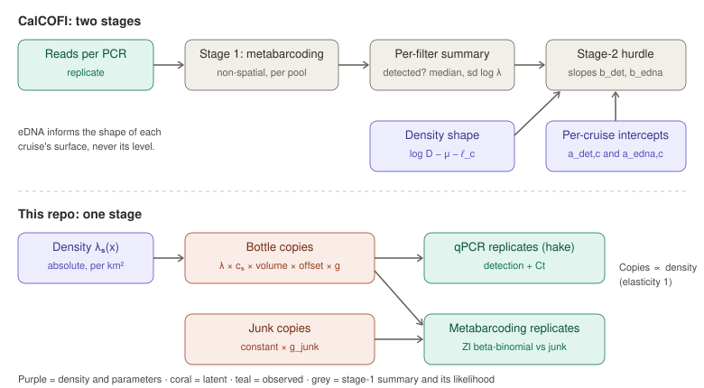

This note compares two projects that fit eDNA and visual survey data to one latent
whale density surface:

- **CalCOFI** (`calcofi-whale-edna-sdm`): Brice Semmens and Eldridge Wisely at
  Scripps/CalCOFI. It builds on Michaela Alksne's visual–acoustic model for CalCOFI
  baleen whales and on Shelton et al.'s quantitative metabarcoding model.
- **This repo** (`eDNAVisualJointModel`): the MURI joint model of eDNA and visual
  line-transect data off the US West Coast. It builds on the HSGP4eDNA eDNA model.

Sources:

- **CalCOFI:** `EXPLAINER.md`, `docs/METHODS.md`, `DATA.md` and the Stan programs
  in `analysis/` (repository state of 14 October 2026).
- **This repo:** `README.md`, `ROADMAP.md` (since archived as `ROADMAP_2026-10-06.md`), `docs/explainer.md` and the Stan
  programs.

Equations are given in each project's own notation where that helps the comparison.

# The short version

Both projects:

- put one latent log-density surface (animals per km²) at the centre;
- represent its spatial residual with a Hilbert-space Gaussian process (HSGP);
- let sightings set the absolute scale and treat eDNA as an index whose link to
  animals has to be learned;
- use descendants of the same metabarcoding measurement model (Shelton et al.), with
  a lumped non-target category and zero-inflated beta-binomial reads.

They differ in four main ways.

1. **Time.**
   - CalCOFI is a 20-year, 77-cruise model with a level and (for six cruises) a
     departure field per cruise.
   - Ours is a single snapshot with no time dimension. It treats the 2018 visual
     survey and the 2019 eDNA survey as seeing the same field.
2. **What explains space.**
   - CalCOFI explains space mainly with environmental covariates: P-splines on
     seasonal climatology and on cruise anomalies of SST, SSH and chlorophyll. A
     coarse, isotropic HSGP (100 functions, about 100 km) catches the rest.
   - Ours has no dynamic covariates. Everything except a bottom-depth spline is
     carried by an anisotropic HSGP with estimated length-scales and up to 800
     functions.
3. **How eDNA enters.**
   - CalCOFI uses two stages: a non-spatial metabarcoding model gives a per-filter
     summary, which enters the density model through a hurdle. That hurdle has free
     elasticities of detection and amount with respect to density.
   - Ours uses one stage: the replicate-level qPCR and metabarcoding likelihood sits
     inside the joint model, and expected copies are proportional to density.
4. **How detection is handled.**
   - CalCOFI plugs in a detection probability from a separately fitted
     distance-sampling model, and models counts as negative binomial.
   - Ours estimates the detection function jointly, with group-size and Beaufort
     covariates and size-bias correction, and models counts as Poisson.

CalCOFI also has a third data stream, passive acoustics, which we do not. We
validate on simulations with a known truth; CalCOFI validates on real data by
PSIS-LOO against a null model.

# Purpose, data and domain

| | CalCOFI whale eDNA SDM | eDNAVisualJointModel |
|---|---|---|
| **Goal** | Cruise-resolved density maps and a 20-year cruise-level abundance index (a survey index for assessment; retrospective "where were the whales on that cruise") | One density surface per species from eDNA and visual data together; calibrate eDNA against animals; fill gaps in either source |
| **Species** | Humpback, fin whale | Humpback, Pacific white-sided dolphin (PWSD); Pacific hake as the eDNA anchor |
| **Region** | CalCOFI grid off southern California (8 km cells). Visual subsegments span 29.9–44.4°N but three-quarters are south of 33.9°N | MURI study area north of 35°N, a 690 × 1,770 km box (UTM 10N) |
| **Time span** | 77 cruises, 2004–2026; eDNA on 6 of them (2023–26) | One visual survey (2018 CCES) and one eDNA survey (2019), treated as one snapshot |
| **Visual** | About 10,500 transect subsegments (Alksne et al.); 638 humpback sightings | 1,641 segments (7,561 km); 548 humpback and 89 PWSD groups within truncation |
| **Acoustic** | Sonobuoys: 1,526 humpback cells (call-minutes), 1,688 fin cells (20 and 40 Hz call counts) | None |
| **eDNA sample** | 248 underway **surface** filters, each integrating a 10–50 km track; 2–4 PCR replicates | 551 Niskin **bottles** at 182 stations, **0–500 m**; about 3 PCR replicates per assay |
| **eDNA assays** | MarVer1 metabarcoding only, two sequencing pools with different protocols | MarVer1 metabarcoding for all species; qPCR for hake |
| **Gaps** | Visual and acoustic data end in 2024, so the 2025–26 cruises are informed by eDNA alone | Real qPCR data lack Ct values in the current pipeline; volumes and conversion factors are placeholders; see `docs/dataQs.md` |

The two domains are close to adjacent, and humpback is in both. A coast-wide
humpback analysis would be a natural joint product later.

# Latent density field

**CalCOFI** (cruise *c*, location *s*):

$$
\log D(s,c) = \mu + \sum_k f_k\big(\bar x_k(s)\big) + \sum_k g_k\big(x_k(s,c) - \bar x_k(s)\big) + w(s) + \eta_c(s) + \ell_c
$$

**Ours** (species *s*, location **x**):

$$
\log \lambda_s(\mathbf{x}) = \mu_s + f_s(X, Y) + h_s(Z_\text{bottom})
$$

| Component | CalCOFI | Ours |
|---|---|---|
| Intercept | μ ~ N(−5.486, 0.261²), informative, from the long-term visual record | μ_s per species; normal(−5, 2) for the cetaceans in the visual and joint models |
| Covariates | SST, SSH, log chlorophyll. Each enters twice, as a P-spline on the seasonal **climatology** (f_k) and a P-spline on the cruise **anomaly** (g_k): cubic B-splines, 4 basis functions, RW2 penalty, one shared smoothness per family | Bottom depth only: natural spline, 4 df. No dynamic covariates |
| Long-term spatial field | w(s): **isotropic** squared-exponential HSGP, **100** basis functions (10 × 10), range ρ ~ lognormal(log 100, 0.5) km, amplitude α ~ half-N(0, 1) | f_s: **anisotropic** squared-exponential HSGP with separate east–west and north–south length-scales per species; basis sized to the prior floor within an **800**-function budget |
| GP priors | Fixed weakly informative priors | **Design-based**: inverse-gamma length-scale priors built from sample spacing, domain extent and basis budget, never from the counts |
| Time-varying terms | η_c(s): per-cruise departure HSGP, 16 functions, range **fixed** at 150 km, one shared amplitude α_η. ℓ_c: per-cruise level, N(0, σ_ℓ²). Fitted for 6 cruises now, all cruises planned | None |
| Identifiability devices | Every additive term **centred** over visual-effort rows (the η basis over the prediction grid); constants subtracted again at prediction | Centred spline; intercept and field trade off (a documented limitation for PWSD's intercept) |

**What this means.**

- **Where the spatial signal goes.** CalCOFI asks the environment to explain space
  first, and gives the GP only coarse residual structure (about 100 km). Our model
  has no environmental covariates, so the GP carries the spatial signal at finer
  scale: simulated length-scales are 50 km east–west and 150 km along the coast.
  This is why our basis is eight times larger.
- **Climatology versus anomaly.** CalCOFI's split into a climatology smooth and an
  anomaly smooth is what lets them partition each cruise's redistribution into
  "environment" and "not environment". That is their headline result:
  - for fin whales, mostly environment;
  - for humpbacks, the two are comparable.

  A single snapshot like ours cannot pose that question.
- **Anisotropy.** Ours is anisotropic because structure along the coast is much
  longer than across it. CalCOFI's is isotropic, which is less of a constraint on a
  more compact domain.

# Visual observation model

| | CalCOFI (Alksne's model, unchanged) | Ours |
|---|---|---|
| Unit | Transect subsegment | 5 km (real) or 10 km (simulated) segment |
| Count model | Groups per subsegment ~ **NegBin₂**(D / E[G] × p̂ × A, φ_v) | Groups per segment ~ **Poisson**(λ / E[s] × 2L × ESW) |
| Detection | p̂: a **plug-in** detection probability from a separately fitted distance-sampling detection function; not re-estimated, so its uncertainty is not propagated | **Estimated jointly** from the perpendicular distances: half-normal or hazard-rate key, truncated at w; log σ = log σ₀ + β_size(s − s̄) + β_bft(Beaufort − 3) |
| Group size | Shifted NB on G − 1, fitted in the same model | Zero-truncated NB (humpback) or log-normal (PWSD), with size-bias correction |
| Sea state | Inside the upstream detection-function fit, if at all | Beaufort covariate on σ (in the visual model; not yet in the joint model) |

**What this means.**

- **Uncertainty and coupling.** Our integrated detection function propagates
  detection uncertainty into density. It also lets detection vary with sea state
  and group size segment by segment. CalCOFI's plug-in is simpler and borrows a
  mature detection model.
- **Overdispersion.** CalCOFI's negative-binomial count model is something we have
  listed but not yet adopted (ROADMAP item 4; now ROADMAP_2026-10-21, section 3). Our real visual fits show
  floor-following short length-scales, which overdispersed counts might explain.

# eDNA observation model

This is where the two projects differ most.

## Structure

CalCOFI turns reads into a per-filter summary first, then links that summary to the
density surface. Ours models the replicate-level data directly from the density field.

{fig-alt="Top row: reads per PCR replicate go into a non-spatial stage-1 metabarcoding model, giving a per-filter summary that enters a stage-2 hurdle together with the density shape and per-cruise intercepts. Bottom row: density times conversion factor, volume, offset and bottle noise gives bottle copies; junk copies have their own noise; qPCR and metabarcoding replicates are modelled from those copies."}

## Component by component

| | CalCOFI | Ours |
|---|---|---|
| **Stages** | Two. Stage 1 turns reads into a per-filter summary; stage 2 uses only that summary | One. The replicate-level qPCR and metabarcoding likelihood is inside the joint model |
| **Spatial structure at the measurement level** | None in stage 1 (one free log λ per filter and species, with a hierarchical prior m_s + τ_s z) | The species' density field |
| **Link from density to DNA** | Free elasticities: b_det for detection and b_edna for amount, plus per-cruise intercepts a_det,c and a_edna,c | **Proportional**: expected copies = λ × c_s × volume × offset, so the elasticity is fixed at 1 |
| **Does eDNA inform the absolute level?** | **Never, by design.** logrel excludes μ and ℓ_c, and the per-cruise intercepts absorb run, library and protocol effects | With c_s **fixed**: yes. With c_s **free** (the cetaceans): no, the visual data set the scale and c_s is estimated, which is the same logic as CalCOFI's per-cruise intercepts for a single survey |
| **Zeros** | Data-level hurdle: "any read in any replicate" is the detection flag | Replicate-level zero inflation: P(target absent from the aliquot) = exp(−λ) |
| **Bottle-to-bottle noise** | Stage 1: the free per-filter λ. Stage 2: residual σ_edna plus the propagated stage-1 sd | Explicit per-bottle factor g, negative binomial, one θ shared by all species |
| **Non-target DNA** | "Other taxa" reference category with its own per-filter λ and learned spread | "Junk" category with a per-bottle factor and its own spread θ_junk |
| **Metabarcoding overdispersion** | log φ = β₀ + log Σλ + γ₀ exp(−γ₁ log λᴷ) + β₁κ | log φ = β₀ + log Σλ + max(γ₀ − γ₁ log λᴷ, 0) |
| **qPCR** | None | Hake: hurdle on detection, Ct linear in log copies |
| **Volume filtered** | Recorded, but enters neither stage (the intercepts absorb it) | An offset; currently a placeholder for the real data |
| **Sampling depth** | Surface only | Water-column offset per species and sampling depth |
| **Sample position** | Filter-track midpoint (10–50 km line) | Bottle position (a point) |

## What CalCOFI found

- **Presence tracks density:** b_det is about 0.95 for humpback and 0.75 for fin
  whale, with intervals excluding zero.
- **Amount does not:** among detected filters, b_edna is about 0.
- **Their conclusion:** for rare whales sampled by underway filters, the usable
  eDNA signal is presence.
- **Why they use a hurdle:** a censored continuous likelihood (Shelton et al.'s
  approach for common species) gave a bimodal intercept and an inflated residual on
  their data.

## What this means for us

- **The proportionality assumption is testable.** Our model assumes copies scale
  one-for-one with density. CalCOFI's result suggests that for whales, read amount
  may carry little density information beyond presence. Freeing an elasticity
  (copies ∝ λ^b) is the direct test. Our zero inflation already uses presence per
  replicate, so this would show whether the amount part of our likelihood adds or
  distorts information.
- **One stage versus two.** Our one-stage likelihood keeps everything a two-stage
  summary throws away:
  - replicate structure;
  - qPCR and metabarcoding sharing the same bottle;
  - non-detect information within detected filters;
  - spatial pooling at the measurement level.

  It also inherits every identifiability problem of the measurement model inside
  the density fit, as our junk and bottle-noise terms show (see below). CalCOFI's
  two stages isolate those problems in stage 1, at the cost of treating the stage-1
  summaries as data.
- **The same identifiability problem without qPCR.** Without a qPCR anchor,
  metabarcoding identifies concentrations only relative to the non-target category.
  - **CalCOFI** sidesteps this with free per-cruise intercepts and a "shape only"
    rule.
  - **Ours** leans on hake qPCR as the absolute anchor. That anchor is weak in the
    current real-data pipeline: there are no Ct values, and we can't confirm that
    qPCR and metabarcoding came from the same bottle.
- **The non-target category is treated alike.** Both projects give the non-target
  category its own sample-to-sample variation. This supports the junk term we added
  in HSGP4eDNA v1.3.

# Acoustics

CalCOFI carries Alksne's two acoustic likelihoods unchanged:

- **Humpback:** beta-binomial on call-minutes. The expected call rate is
  D × seasonal cue rate × monitored area, with detector false-negative and
  false-positive corrections.
- **Fin whale:** negative binomial on 20 Hz and 40 Hz call counts.

Seasonal cue rates carry informative lognormal priors, so acoustics contribute
shape and some scale through those priors. We have no acoustic stream.

# Inference, comparison and validation

| | CalCOFI | Ours |
|---|---|---|
| **Software** | Stan (rstan) for reported fits; an **RTMB/Laplace twin** for development, sensitivity and cross-validation (5–15 min against 2–5 h) | Stan (cmdstanr) only |
| **Model comparison** | Full against a null without η_c, by **PSIS-LOO** on pointwise log-likelihoods; leave-one-cruise-out planned for high Pareto-k eDNA rows | eDNA-only, visual-only and joint fits with identical priors and basis, switched by data flags. Exactness checks: switching one likelihood off reproduces the single-source model's log density to 3e-11 |
| **Validation** | Real data only. No simulation-based recovery study | Simulations from a known truth on the real study domain: field R², interval coverage, hyperparameter and conversion-factor recovery, over several seeds |
| **Known sampling issues** | σ_ℓ funnel (non-centred form planned); humpback full fit 6% divergent after a longer warm-up | Intermittent junk-noise mode in joint fits (now 4 chains); simulation seed 1's eDNA fits stuck at extreme hot spots; real-data length-scales at the prior floor |

# What each project could take from the other

**For us, from CalCOFI**

1. Free an eDNA–density elasticity and test whether copies are proportional to
   density. Their b_edna ≈ 0 is the strongest reason to check.
2. Negative-binomial segment counts (already ROADMAP item 4; now ROADMAP_2026-10-21, section 3).
3. Their split into a climatology smooth and an anomaly smooth, if we ever fit more
   than one survey or add dynamic covariates. It is a clean way to separate habitat
   from redistribution.
4. An RTMB or Laplace twin for fast iteration on the real-data fits, which take
   hours in Stan.
5. Their eDNA-versus-sighting distance check (detection probability against
   distance to the nearest sighting) as a model-free first look at our 2018 and
   2019 data. Here it would be confounded by the one-year gap between surveys.

**For CalCOFI, from us**

1. A jointly estimated detection function, so detection uncertainty and sea state
   reach the density surface.
2. A simulation study with a known truth. In particular, check whether their
   b_det/b_edna split and the η_c-versus-anomaly partition are recoverable at their
   sample sizes.
3. Design-based GP priors and floor checks for their HSGP length-scales.
4. A one-stage eDNA likelihood as a sensitivity check on the two-stage summary,
   which treats stage-1 medians and sds as data.

**Shared open questions**

- How much non-target DNA varies between samples, and whether anything other than
  an absolute anchor (qPCR or ddPCR) can pin it down.
- Whether a surface filter integrating 10–50 km and a Niskin bottle at a point
  sample the same "effective area". CalCOFI reports this area per cruise as
  exp(a_det,c). Our conversion factor c_s plays the same role, so the two could be
  compared directly.
