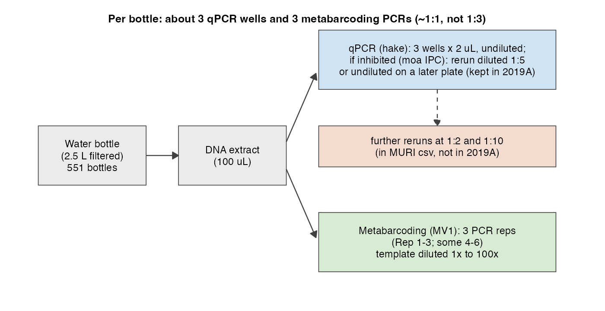
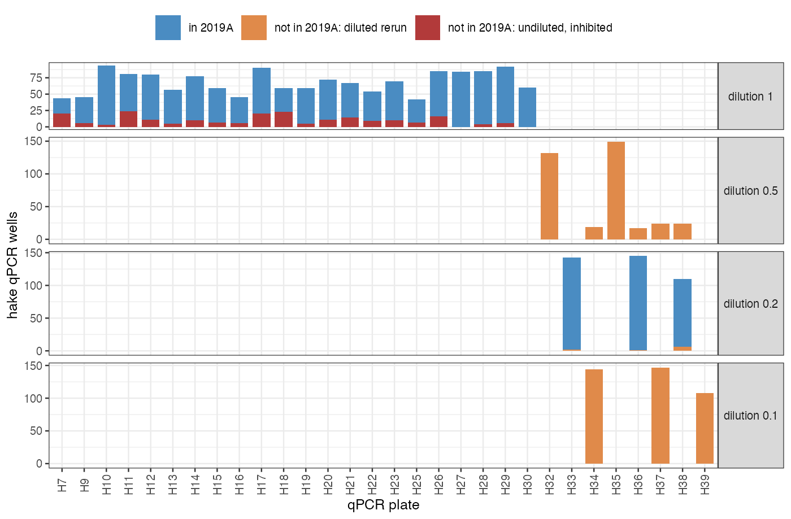

# Why we are asking

The joint eDNA + visual model needs, for hake, the **raw qPCR Ct values** and the
**standard curve** (intercept, slope, amplification efficiency, Ct noise) that go with them. Until now we
only had copies/µL from `hake_qPCR_MURI_df.csv`, so the real-data fits used placeholder qPCR
parameters. We now have `qPCR_2019A.rds` (Ole) and the Stan code from the qPCR vignette. This note
summarises how those line up with the metabarcoding data already in hand, and lists the
decisions we need your input on (see *Questions* below).

# What we have

| File | Content |
|---|---|
| `hake_qPCR_MURI_df.csv` | 2,663 hake qPCR wells, 562 sample IDs, 551 bottles; copies/µL, dilution, inhibition rate, plate. **No Ct, no well ID.** |
| `MV1_MURI_df.csv` | 1,709 metabarcoding (MV1) PCR replicates from the same 551 bottles; reads per taxon, `Rep`, template `Dilution`. |
| `qPCR_2019A.rds` | 2019 survey (2 Jul to 17 Aug), "analysis A": field wells with **Ct**, copies/µL, dilution, inhibition rate, plate, well, `drop.sample`, filtered volume; hake **standards** on all 33 plates; field negatives; NTCs. |
| `qPCR/*.stan`, `qPCR_vignette_part_1.qmd` | Standard-curve models from the vignette (single- and multi-plate), field-sample model. |

`qPCR_2019A.rds` is the same data as the earlier `qPCR_2019.rds` except that sample IDs now carry
the project prefix (`52193_282`), bathymetry columns were revised, and `qpcr_analysis` / `project`
columns were added.

# How qPCR and metabarcoding correspond, bottle by bottle

{width=95%}

| Per bottle | qPCR (hake) | Metabarcoding (MV1) |
|---|---|---|
| Typical | **3 wells** on one plate, one dilution (855 of 922 sample $\times$ plate $\times$ dilution groups) | **3 PCR replicates** (417 of 551 bottles; 82 have 4) |
| Extras | Reruns of inhibited samples on later plates and/or at higher dilution | `Rep` 4 to 6 on some bottles |
| Dilution | 1, 0.2 (1:5), 0.5 (1:2), 0.1 (1:10); coded as a *fraction* | 1x to 100x; coded as a *fold* |
| Total | 2,663 wells | 1,709 PCR replicates |

We had understood the design as **one qPCR to three metabarcoding reactions per bottle**. The
files instead show roughly **3 qPCR wells to 3 metabarcoding PCRs** (about 1:1). Our reading is
"one qPCR assay of the extract, run as a technical triplicate", alongside three independent
metabarcoding PCRs. The overall 2,663 / 1,709 = 1.56 ratio comes from qPCR reruns, not the
basic design. Eleven bottles have two qPCR sample IDs (field duplicates, or the 30EtOH pairs?).

# Which qPCR wells are in analysis A

All 562 of our sample IDs are in `qPCR_2019A.rds`, and 1,673 of our 2,663 wells match it exactly
(same sample, plate and inhibition rate; copies/µL agree for 99.8%). The other **990 wells are not
in analysis A**. They are not random; they are all inhibition-related (Figure 2):

| Wells in our csv | in 2019A | not in 2019A | Inhibition rate (median) |
|---|---:|---:|---|
| Undiluted (1) | 1,284 | 217 | 0.69 for the 217 dropped wells (41% > 0.75) |
| 1:5 (0.2) | 389 | 9 | 0.06 for the kept wells |
| 1:2 (0.5) | 0 | 365 | 0.12 for the 0.5 and 0.1 reruns combined |
| 1:10 (0.1) | 0 | 399 | |
| **Total** | **1,673** | **990** | |

{width=95%}

- **134 samples** were inhibited when undiluted (by the moa internal control) and rerun diluted.
  Analysis A keeps their **1:5 triplicate** and drops the undiluted wells and the 1:2 / 1:10 runs
  (plates H32, H34, H35, H37, H39 entirely, and part of H36 and H38).
- **45 further samples** had inhibited undiluted wells dropped without a diluted rerun. Analysis A
  keeps their other wells, mostly an undiluted rerun on a later plate (e.g. H9 to H17).
- Every bottle that was rerun for qPCR was also diluted for metabarcoding (134 of 134); 148 more
  were diluted for metabarcoding only. So the dilutions appear to be driven by inhibition of the
  extract, applied to both assays, with metabarcoding diluted more often.
- After this cleaning, almost every sample has **exactly one triplicate** in analysis A (508 of
  562 samples have 3 wells); no sample is lost.

Two other things in analysis A for our samples:

- `drop.sample = "30EtOH"` on 166 wells (56 samples). We currently keep these.
- 180 of 1,426 detected wells have **Ct > 37.5** (max 44.7). The vignette source has a
  "Ct > 37.5 = non-detection" recode, but it is commented out.

# Standard curve and Stan code

- Hake standards (gBlocks, 1 to $10^5$ copies/µL) are on all 33 plates, including every plate our
  wells were run on: 765 wells, 106 inhibited (> 0.75, mostly $10^5$), 26 non-detects.
- `qPCR_standards_multi-plate.stan` (per-plate $\beta_0, \beta_1$; shared $\gamma_0, \gamma_1,
  \sigma_0, \phi$; slope bound $\beta_1 \le -1/\ln 2$) compiles and is what we would fit first. Its
  parameters map onto our qPCR hurdle as $\alpha_{ct} = \beta_0$, $\beta_{ct} = -\beta_1$,
  $\kappa = \phi$, with $\gamma_0, \gamma_1, \sigma_0$ unchanged (our $\lambda$ = copies in the
  2 µL reaction, i.e. $2K$).
- `qPCR_simple.stan` (standards + field samples jointly) does not compile as sent (old array syntax,
  `bin_obs` vs `bin_obs_stand`); the fixes are small. `qPCR_controls.stan` and
  `qPCR_standards_multi-plate_nobin.stan` look like work in progress.
- None of the compiling models has a **dilution offset**. We would add $\log(\text{dilution})$ to
  $\log\lambda$ for each well, so a 1:5 well is not read as a sample with 5x less DNA.

# Questions

1. **Design.** Is it right that each bottle got one qPCR assay (technical triplicate) and three
   metabarcoding PCRs? What are the eleven bottles with two qPCR sample IDs?
2. **Reruns.** Is analysis A deliberately "one clean triplicate per sample"? Should we drop the
   undiluted inhibited wells and the 1:2 / 1:10 reruns too, or are the 1:2 / 1:10 runs usable
   extra information (with a dilution offset)?
3. **30EtOH.** Should samples flagged `30EtOH` / `30EtOHpaired` be excluded?
4. **Late Ct.** Should detected wells with Ct > 37.5 count as detections or as non-detections?
5. **Inhibition cutoff.** Is 0.75 the threshold for field samples as well as standards, and is
   analysis A already filtered on it?
6. **Metabarcoding dilution.** Was MV1 template dilution (5x to 100x) also inhibition-driven? Is
   there a reason not to treat it as a known offset on amplifiable copies?
7. **Bathymetry.** Which depth column (`bathy.bottom.depth` or `bottom.depth.consensus`) do you
   recommend? We currently take bottom depth from ETOPO 2022.

# Answers (Ole, October 2026)

1. **Design.** Match qPCR and metabarcoding on sample number.
2. **Reruns / dilution.** Qualify dilution as an offset in the qPCR model (0.1 means 1:10).
   Metabarcoding needs an offset too.
3. **30EtOH.** A lab mix-up lost about 20 to 30% of the hake DNA in these samples. Either estimate
   the loss with hake qPCR and assume it is the same for the other taxa, or exclude them; which
   depends on how many were metabarcoded (56 of 569, 10%).
4. **Late Ct.** The 2019 outliers have already been dealt with; use the observations as provided.
5. **Inhibition.** The 2019 qPCR is cleaned: no inhibited observations remain, and there is one
   dilution per sample.
6. **Metabarcoding dilution.** An offset.
7. **Bathymetry.** Not yet answered.

Since then we have also received `M3_compiled_taxon_table_wide.csv` (reads per taxon for six
markers; we use MarVer1) and `Hake_2019_metadata.csv`, and use `depth_cat` (target depth) in
place of recorded depth.

# What we did

- Hake qPCR: all analysis-A wells, Ct and dilution as provided (1,532 wells, 513 bottles after
  dropping the 30EtOH samples for now).
- Standard curves per plate, estimated from the hake standards (`stan/qpcr_standards.stan`,
  after the multi-plate vignette model): intercepts 36.1 to 39.9, slopes 1.45 to 1.49 Ct per
  log copy (efficiency 0.95 to 1.00), detection rate 0.90 per copy.
- Dilutions as offsets: log fraction for qPCR, minus log fold for metabarcoding. Where a bottle
  was metabarcoded at several dilutions, the dilution with the most reads is kept.

# Follow-up questions

- **Hake in field negatives.** 73 of 114 evaporated-DI and 25 of 72 lab-DI field-negative wells
  detect hake (up to about 12 copies/µL); extraction and PCR controls are clean. Is this known,
  and should field samples be corrected for it?
- **Copies/µL.** The `copies_ul` in analysis A run about 20 to 30% below the copies we
  back-calculate from the per-plate curves, at both dilutions (1 and 1:5). Are they already
  corrected for dilution? (We model Ct, so this does not affect the fit.)
- **Template volumes.** 2 µL per qPCR reaction (as for the standards)? Template volume and
  elution volume for the MarVer1 PCRs?
- **Bottom depth** (question 7).

*Numbers and figures: `docs/dataQs/make_figs.R`.*
