> **Status of this draft.** Every figure in Sections 2 to 4 was produced from the
> code in this repository (`docs/explainer/`). **Section 5 (the joint model)
> summarises results recorded in the repository by the Phase 5 work; I did not
> re-run them for this document** (Section 5.2.2 adds the current set-up). The
> joint model's real-data fits are under way: visual-only done, eDNA-only and
> joint running. Items that need your input are marked **[REVIEW]**, and the
> open questions are collected in Section 6.

> **Out of date: set-up changed on 2026-10-12** (HSGP4eDNA v1.4,
> eDNAVisualJointModel #82). Every analysis is now restricted to the study
> area **north of 35°N**, one 690 × 1770 km box shared by the simulations and
> the real data. The changes:
>
> | | This document | Current set-up |
> |---|---|---|
> | Simulation box | 500 × 1270 km, about 37.7–49.2°N | 690 × 1770 km, 35°N northwards |
> | Simulated length-scales | 50 km E–W × 300 km N–S | 50 km E–W × 150 km N–S |
> | Simulated transects | 25 (1250 segments) | 35 (2415 segments) |
> | Basis budget | 400 functions | 800 functions |
> | Real visual effort | 2779 segments (12,967 km), from 27.4°N | 1617 segments (7,441 km), north of 35°N, Beaufort ≤ 5 |
> | Real-data domain | 1360 × 2600 km | 690 × 1770 km |
>
> **Every number and figure below predates these changes** and will be
> regenerated after the re-runs listed in ROADMAP_2026-10-21, section 3, **except the
> joint model's simulation results (Section 5), which are on the current
> set-up** (seed 1, 2026-10-13). The real eDNA bottles (all north of 35°N) are
> unchanged; the real eDNA fit's numbers still change through the new domain
> and budget.

> **Added on 2026-10-22** (eDNAVisualJointModel #103, #104): the newer material
> is marked "35°N" or dated, and sits alongside the older sections.
>
> - **Visual model:** optional **negative-binomial segment counts** (clustered
>   sightings) and a **visibility** covariate on detection, both per species
>   and switched off exactly (Section 4). A simulation check of whether
>   clustered sightings explain the real fits' short length-scales (they do
>   not; Section 4.4.2).
> - **Real visual data:** effort restricted to Beaufort ≤ 5; PWSD uses
>   visibility; NB counts for both species; new fits on the 35°N data
>   (Section 4.5.2), and the decision to keep the 800-function basis and read
>   the length-scale floor as a resolution limit.
> - **Real eDNA data:** the qPCR lab's analysis-A file (Ct, standards), the new
>   metabarcoding table and metadata, per-plate standard curves, dilutions,
>   target depths, a 1,000-read minimum per replicate and the lab's answers
>   (Section 3.3). The real eDNA fit shown predates them.

> **Updated on 2026-10-27** (eDNAVisualJointModel #106–#108), for discussion
> with Len and Ole. Start with **Section 6, "For discussion"**, which lists
> the open questions for each of them.
>
> - **eDNA model:** HSGP4eDNA is now v1.12, and the joint model has its new
>   options: dilution offsets, filtered volume per bottle, **per-plate qPCR
>   standard curves estimated from the standards**, a sampling-depth smooth
>   and a bounded Ct-noise SD, each exact when switched off (Section 3.1).
>   The hake standard curves fitted on their own are in Section 3.3.
> - **Simulation, seed 1 on the current set-up** (v1.12, sea state, NB
>   segment counts): the joint fit is again best for both cetaceans and
>   recovers the conversion factors (Section 5.2.2; preliminary, its joint
>   fits are being re-run with a fix).
> - **Two sampler problems found and fixed:** the junk-noise term needs its
>   non-centred form on the new simulator, and the NB size needed a bound
>   (Sections 3.1 and 4.2).
> - **Real data:** the joint model's visual-only fit to the real data matches
>   the visual model (Section 4.5.2). **The real eDNA and joint fits are
>   running** (on the stats3 server, about two more days) and are not in this
>   document yet.

# What this document is

The aim of the project is to estimate where marine mammals and fish are, using two
very different kinds of data at once:

- **Visual line-transect surveys**: observers on a ship count groups of animals
  and record how far off the trackline each was.
- **Environmental DNA (eDNA)**: water bottles are filtered and the DNA of each
  species is counted by qPCR (hake only) and by metabarcoding (all species).

Both are noisy and indirect measures of the same thing, the density of animals in
space. The modelling idea is to give each species **one latent density surface**
and attach a separate observation model to it for each data source.

This document walks through everything we have built and tested, in the order a
reader would meet it:

1. the model in one page (this section);
2. how test data are simulated, for both data types;
3. the eDNA-only spatial model, on simulated and real data;
4. the visual (distance sampling) spatial model, on simulated and real data;
5. the joint model, on simulated data (real data not yet run);
6. limitations, and how to reproduce the figures.

## The model in one page

For species $s$ at location $x = (X, Y)$ with bottom depth $Z$:

$$
\log \lambda_s(x) \;=\; \mu_s \;+\; f_s(X, Y) \;+\; h_s(Z_\text{bathy})
\qquad \text{(animals per km}^2\text{)}
$$

- $\mu_s$ is an intercept.
- $f_s$ is a **Gaussian process** over position, one per species, with separate
  length-scales east-west and north-south (anisotropic). It is computed with a
  **Hilbert-space approximation (HSGP)**: the GP is written as a weighted sum of a
  fixed set of sine basis functions, so the sampler works with a few hundred
  coefficients instead of an $N \times N$ covariance matrix.
- $h_s$ is a smooth effect of **bottom depth**, a natural spline with 4 degrees of
  freedom.

Each data source then has its own observation model on top of $\lambda_s$:

| Data | Observation model |
|---|---|
| eDNA, qPCR (hake only) | Expected copies in a reaction $=\lambda_s \times$ conversion factor $\times$ litres filtered $\times$ water-column offset $\times$ bottle noise $\times$ aliquot fraction ($\times$ the well's dilution). Detection is $1-\exp(-\kappa \cdot \text{copies})$. Detected replicates have a Ct that falls linearly in the log of copies, on a standard curve that can be fixed or estimated per plate from the standards. |
| eDNA, metabarcoding (all species) | Zero-inflated beta-binomial on read counts, with read shares proportional to each species' copies relative to a "junk" background of all non-target DNA. |
| Visual line transects | Detected groups per segment are Poisson (or negative binomial, for clustered sightings) with mean $\lambda_s / E[\text{group size}] \times 2 L \times \text{ESW}$, where ESW is the effective strip half-width implied by the detection function. Perpendicular distances follow the detection function, whose scale can depend on group size, Beaufort and visibility. |

Everything downstream is about whether this structure can be fitted reliably, and
whether its parts behave when they meet real data.

## Which model variants exist

The upstream eDNA repository (HSGP4eDNA) contains several spatial variants: a 2-D
GP over (X, Y) only; a 3-D GP with bottom depth as a third axis; and a 2-D GP plus
a **spline on bottom depth**. This document focuses on the last one, the 2-D HSGP
plus spline, because it is the cheap structure used by the visual and joint models.
The eDNA tests shown here use the scenario with **species-specific water-column
depth preferences** (`bathysp_depthspref`): bottles are taken at six depths, and
each species' eDNA concentration peaks at a different depth.

## Versions and where the code lives

| Piece | Where |
|---|---|
| eDNA model, HSGP functions, eDNA simulators | `external/HSGP4eDNA` (submodule, v1.12, `5515a04`, from 2026-10-23; the eDNA results in this document were made with v1.3 to v1.5) |
| Visual model | `stan/hsgp_visual.stan`, `stan/include/visual_functions.stan` |
| Visual and joint simulators | `R/functions_visual.R`, `R/functions_joint.R` |
| Joint model | `stan/hsgp_joint.stan`, `R/fit_joint.r`, `R/compare_joint.r` |
| Real-data loader | `R/01_load_muri.r`, notes in `notes/muri_data_formatting.md` |
| Figure scripts for this document | `docs/explainer/` |

# Data simulation

Every model in the repository is first tested on data simulated from a known truth,
so that "does the model recover the truth?" has an answer.

## One latent field per species

Three species are simulated, chosen to span how informative each data source is:

| Species | eDNA | Visual | Baseline density | GP marginal SD |
|---|---|---|---|---|
| Pacific hake | qPCR and metabarcoding | not surveyed | 15 per km² | 2.0 |
| Humpback whale | metabarcoding only | yes (400 to 1000 detections) | 0.01 per km² | 1.0 |
| Pacific white-sided dolphin (PWSD) | metabarcoding only | yes (40 to 120 detections) | 0.02 per km² | 1.3 |

All three share the same GP length-scales: 50 km east-west and 300 km north-south,
which mimics an ocean where structure runs along the coast.

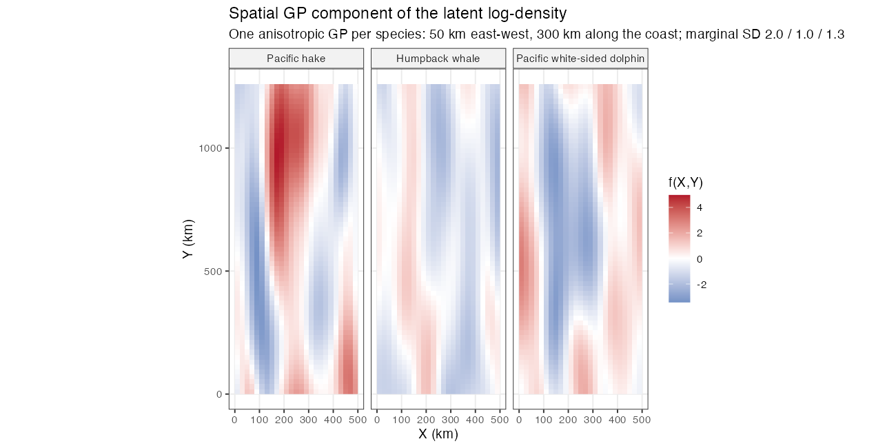

The bottom-depth effect $h_s$ and the water-column preference are separate,
smooth, known functions:

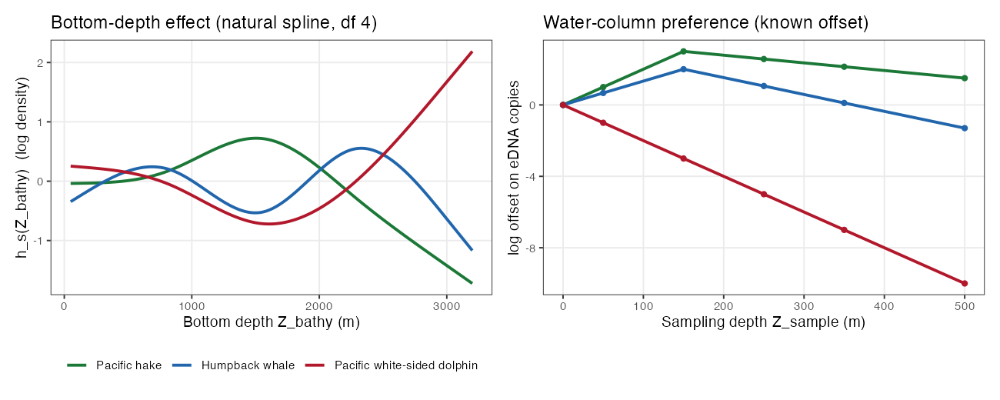

## Simulating eDNA observations

Given the density at each bottle, the simulator generates data in the same order
that nature does:

1. **Bottle copies.** Expected copies = density $\times$ a conversion factor
   (hake 10, humpback 200, PWSD 110) $\times$ litres filtered $\times$ the known
   water-column offset. The realised copy count is negative binomial around that
   mean ($\theta = 10$), which is **between-bottle noise**.
2. **Aliquot.** A small fraction of the bottle (2 $\mu$L of a 100 $\mu$L elution)
   goes into each PCR. The copies that land in it are binomial.
3. **qPCR (hake).** Detection with probability $1 - e^{-\kappa c}$, $\kappa = 0.85$,
   then a Ct that falls linearly in $\ln c$ with measurement noise.
4. **Metabarcoding.** Reads are split among the three species and a **junk**
   category in proportion to their copies; junk varies from bottle to bottle.
   - **Junk** stands for all reads that are not hake, humpback or PWSD. Each
     sample gets one junk draw, shared by its three metabarcoding replicates
     because they come from one bottle. The bottle's junk copies are a
     negative-binomial draw, then subsampled into the aliquot like the species'
     copies. That gives about 50 junk copies per aliquot, with a between-sample
     CV of about 0.2. *(Planned change, HSGP4eDNA's roadmap: redraw the junk
     copies for each aliquot as for the species, so they also vary between a
     bottle's replicates. In the real data, the share of a bottle's main junk
     taxon varies between its replicates a median 570× more than multinomial
     sampling alone gives.)*
   - Junk has **no spatial structure and no qPCR**: it is the same in
     expectation everywhere, and only metabarcoding sees it.
   - **Reads.** Each replicate draws a sequencing depth: 80% of replicates are
     log-normal around 75,000 reads, and 20% around 40,000 with a wide spread,
     clipped to 1,000–250,000. The depth is then split multinomially across the
     species' and junk's aliquot copies. Junk takes about 90% of the reads in a
     typical sample; at hake hot spots the share flips.

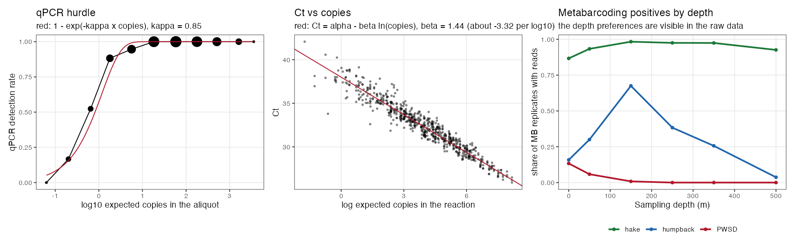

The whales sit near the detection limit: about 0.04 to 0.08 expected copies in a
typical aliquot, so only about 10% of aliquots contain any whale DNA. That is the
reason eDNA alone constrains the whale fields only weakly, and one reason the
visual data matter.

## Simulating visual surveys

The same field is observed along 25 east-west transects split into 10 km segments.
In each segment the number of animal groups in the strip is Poisson; each group is
at a uniform random distance out to the truncation distance (5 km) and is detected
with probability given by the detection function.

- **Humpback:** half-normal detection with scale 2.5 km, groups of 1 to 8.
- **PWSD:** half-normal with scale 1.5 km at the mean group size, wider for larger
  groups, groups of 2 to 452. Group sizes are resampled from the real survey's
  pools (`data/grpsz/`).
- **Sea state (optional):** detection falls with Beaufort, with a spatial trend in
  sea state so that ignoring it biases the field (details below).

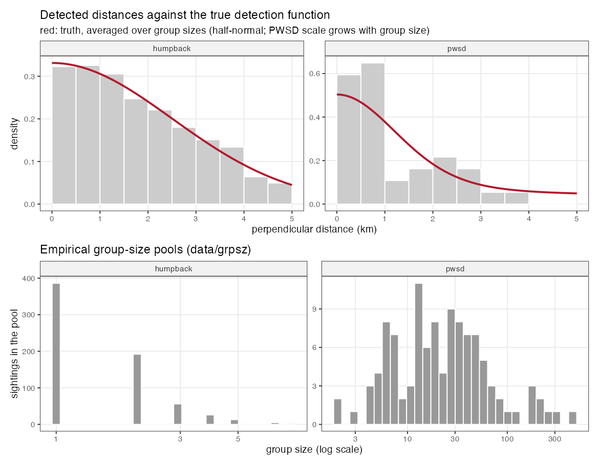

### How sea state is simulated

With `sea_state = TRUE` each segment gets a Beaufort value, and that value changes the
detection scale of every group seen from it:

$$
b = 3 + 1.0\left(\frac{2Y}{Y_\max} - 1\right) + 0.75\left(1 - \frac{2X}{X_\max}\right) + \varepsilon,
\qquad \varepsilon \sim N(0, 0.5),\quad b \in [0, 6]
$$

$$
\sigma \;=\; \sigma_\text{det}\; e^{\beta_\text{size}(s - \bar s)}\; e^{\beta_\text{bft}(b - 3)},
\qquad g(x) = \exp\!\left(-\frac{x^2}{2\sigma^2}\right)
$$

- **The trend** makes the north (large $Y$) and the west (small $X$, the offshore side)
  rougher, with segment-level noise on top. The mean is 3 and the trend spans about
  $\pm 1.75$ Beaufort units.
- **The effect** is a log-linear multiplier on the detection scale, equal to 1 at
  Beaufort 3. The truths are $\beta_\text{bft} = -0.08$ (humpback) and $-0.15$
  (PWSD) per Beaufort unit.
- **Density does not depend on sea state.** Only the chance of seeing a group does.
  Because sea state is correlated with position, a model that ignores it reads the
  rough north and west as low density; the validation measured field shifts of up to
  0.58 log units across the survey.


Averaged over a 5 km strip, going from Beaufort 1 to 5 lowers the detection
probability from 0.67 to 0.52 for humpback and from 0.50 to 0.28 for PWSD (at the
reference group size). The simulator uses the same log-linear form that the model
fits, so a fit to simulated data has the right structure by construction; real sea
state is also not a smooth spatial trend, and rough days are often not surveyed.

## The joint simulator

`simulate_joint()` draws **one** field over the union of eDNA station and transect
segment locations, then generates both data types from it. Each half has exactly
the shape of its single-source simulator's output, so every single-source tool
works on it unchanged.

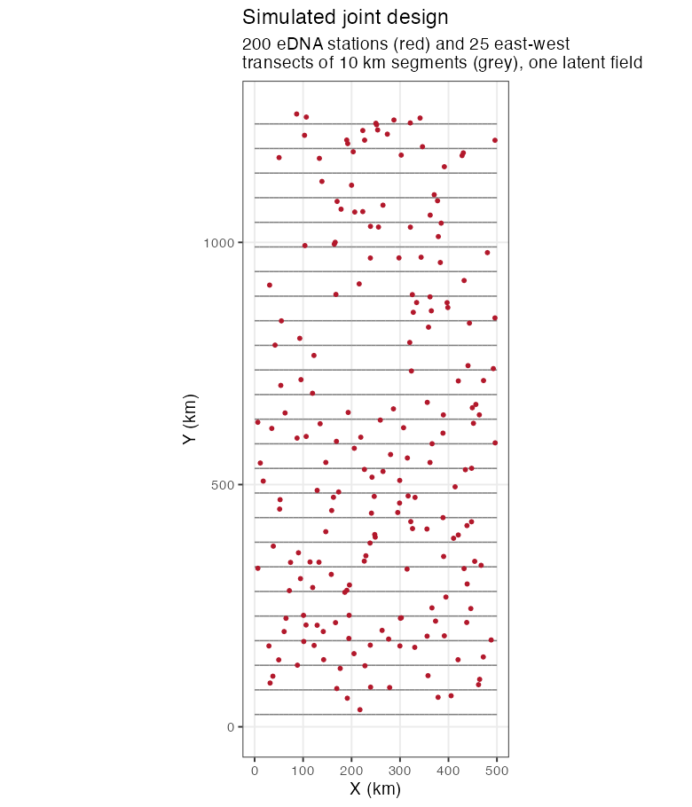

The check that the two halves really see the same field (from the Phase 4
validation, two seeds):

| Check | Result |
|---|---|
| Field correlation between stations and segments within 10 km | 0.995 to 0.997 |
| eDNA-only fit on the eDNA half: field R² (hake / humpback / PWSD) | 0.98 / 0.73 / 0.68 and 0.98 / 0.58 / 0.65 |
| Visual-only fit on the visual half: field R² (humpback / PWSD) | 0.90 / 0.54 and 0.87 / 0.58 |

PWSD is weak in both sources, which is where a joint fit should help most.

# The eDNA-only spatial model

## Structure

The model is `stan/hsgp_2d_bathysp.stan` in HSGP4eDNA. Its main ingredients, beyond
the observation model above, are:

- **Design-based GP priors.** Priors on the length-scales and marginal SD are
  built from the **sample locations only**, never from observed counts. The
  length-scale prior is inverse-gamma with 1% of its mass below a floor
  $\ell_\min$ (the larger of the median sample spacing and the shortest scale a
  basis of the budget can represent: 400 functions in the older fits here, 800
  now) and 1% above the domain extent. The basis size is chosen to match
  $\ell_\min$. The marginal SD's prior has 1% of its mass above 3 in the older
  fits and above 5 since HSGP4eDNA v1.11.
- **Between-bottle noise.** A negative-binomial multiplier on each bottle's expected
  copies, with one spread $\theta$ shared across species. Leaving it out makes the
  GP absorb bottle noise as spurious small-scale structure.
- **Junk noise.** The junk background also varies between samples, with its own
  spread $\theta_\text{junk}$. Without it the species' noise term absorbs junk
  variation and $\theta$ reads about 7 against a true 10.

**How junk is modelled.** Metabarcoding reads are shares, so every species is
measured relative to junk.

- **A category of its own, without a spatial field.** Junk is the last
  category. It has its own intercept $\mu_\text{junk}$ (prior normal(2, 1.5))
  and a fixed conversion factor:
  $\log(\text{junk copies}_i) = \mu_\text{junk} + \log c_\text{junk} +
  \log(\text{litres}) + \log g_{\text{junk},i}$.
- **Per-sample noise.** $g_{\text{junk},i} \sim \text{Gamma}(\theta_\text{junk},
  \theta_\text{junk})$ has mean 1 and is shared by the sample's replicates.
  $\theta_\text{junk}$ is estimated, with
  $1/\sqrt{\theta_\text{junk}} \sim$ half-normal(0, 1). In HSGP4eDNA,
  `JUNK_DIST=lognormal` gives a non-centred version and `JUNK_NOISE=0` holds
  junk constant. **Sampling problem found on 2026-10-23:** since HSGP4eDNA
  v1.7 the simulator redraws junk for every replicate, so once the dilutions
  are modelled the per-bottle junk spread has little to explain and sits
  near 0. There the centred form mixes badly (R-hat 1.58, effective sample
  size 7 for $\theta_\text{junk}$); the non-centred form, or no junk noise,
  mixes well (R-hat 1.02) with the same recovery. The simulation runs now use
  the non-centred form.
- **Read shares.** Each category's expected share is its presence-conditioned
  aliquot copies relative to junk. Its reads are zero-inflated beta-binomial,
  present with probability $1 - e^{-\text{copies}}$.
- **What anchors it.** Metabarcoding alone fixes copies only relative to junk.
  Hake qPCR gives absolute copies, which pins the junk level, and through it
  the other species' copies. The real data now have Ct values, so the real
  fits have this anchor (the earlier real fit in Section 3.3 did not).
- **Approximations.** $\theta_\text{junk}$ has no exact simulation truth: the CV
  of 0.2 implies about 24, and fits give about 13–19, so it is a nuisance
  parameter. The model's independent beta-binomial per category approximates
  the simulator's multinomial split of the reads.
- **A mechanistic overdispersion** (built in HSGP4eDNA v1.7 behind a switch,
  experimental and not used here; ported from Shannon Kachel's bbqm). The beta-binomial φ and the read shares
  would follow from Poisson copies in each aliquot and per-category PCR
  amplification, instead of a fitted curve. Junk becomes a composite category
  with a free amplification efficiency, a global offset on log φ checks the
  mechanism, and amplification efficiencies and per-replicate dilutions enter
  as data. Because φ then grows with the total copies, the spread between
  replicates carries information on absolute copies as well as relative
  abundance.
- **Known water-column offset.** Depth preferences enter as a fixed offset per
  sample and species; the model does not estimate them, unless the depth
  smooth below is on.

**Options added in HSGP4eDNA v1.8–v1.12** (in the joint model since
2026-10-23). Each is off by default, and with it off the model is exactly the
earlier one; with them on and the visual likelihood off, the joint model
equals HSGP4eDNA's own model on the same data (spread of the log-density
difference 3e-11 over random parameter values):

- **Dilution offsets.** Each qPCR well and metabarcoding replicate adds the log
  of its dilution to the copies in its aliquot, so a 1:5 well is not read as a
  bottle with five times less DNA.
- **Filtered volume per bottle** instead of one value.
- **Standard curves estimated in the model.** Each plate $p$ gets its own
  intercept and slope, Ct $= \alpha_p - \beta_p \log(\text{copies})$ with
  $\beta_p \ge 1/\ln 2$ (at most a doubling per cycle); the Ct noise and the
  detection rate $\kappa$ are shared across plates. The standards (known
  copies) enter as data alongside the field wells, so the curves' uncertainty
  carries into the density estimates. This follows the qPCR vignette's
  field-sample model, with its priors.
- **Sampling-depth smooth.** A natural spline in sampling depth (3 degrees of
  freedom, anchored at the surface) on each species' eDNA copies, in place of
  the fixed water-column offset. The intercepts then still mean density as
  sampled at the surface.
- **Bounded Ct noise at very low copies** (v1.12): the Ct-noise SD is
  evaluated at the expected copies given detection, so it cannot grow without
  limit as copies fall.


## Test on simulated data

**Setup.** A `bathysp_depthspref`-style simulation (seed 303) with 40 stations and 6
sampling depths (0 to 500 m): 235 bottles (samples deeper than the sea floor are
dropped), with 705 qPCR and 705 metabarcoding replicates. The basis has 144
functions (12 by 12), set by the design-based prior rule with a budget of 150.
Three chains of 400 + 400 iterations.

| | |
|---|---|
| Runtime (3 chains) | 84 min |
| Divergences | 0 |
| Transitions at the maximum treedepth (10) | 468 of 1200 (39%; 400 in chain 1, 68 in chain 2, 0 in chain 3) |
| max Rhat (hyperparameters, $\theta$) / min bulk ESS | 1.02 / 179 |
| E-BFMI per chain | 0.53, 0.36, 0.65 |

> **[REVIEW]** This is a **reduced version** of the reference scenario (the validated
> run has 200 stations, 1185 bottles, a 400-function basis, and takes about 15
> hours; a first attempt at 80 stations was projected to take about 20 hours on
> this shared machine). The sampler is not clean: 39% of transitions were
> truncated at treedepth 10 and the minimum ESS is only 179. The results are
> indicative; the 1185-bottle numbers in the table below are the reference.

### Recovery of the latent field and hyperparameters

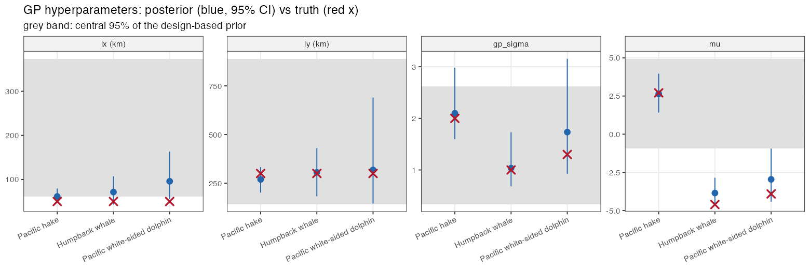

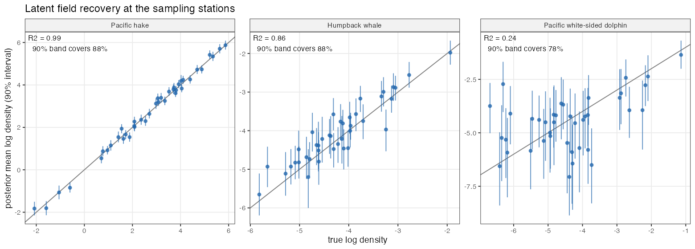

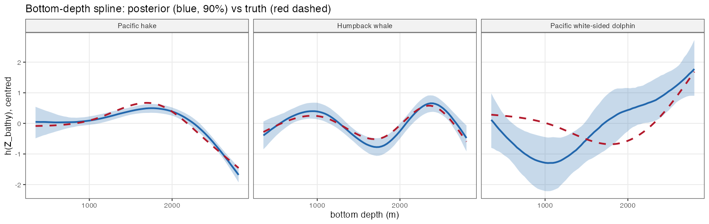

| | Hake | Humpback | PWSD |
|---|---|---|---|
| Field R² at the stations | 0.99 | 0.86 | 0.24 |
| 90% intervals covering the truth | 88% | 88% | 78% |
| Hyperparameters covered (of 4) | 4 | 3 (intercept $\mu$ misses) | 3 ($\ell_x$ misses) |

Ten of twelve hyperparameter intervals contain the truth. Hake is recovered very
well (R² 0.99). The humpback field is recovered with the right shape (R² 0.86). PWSD
is poorly recovered (R² 0.24): its eDNA is surface-associated and almost never
detected below 50 m, so 40 stations carry little information. The two misses are
both small: the humpback intercept's interval is [$-4.56$, $-2.85$] against a
truth of $-4.61$, and PWSD's east-west length-scale is 96 km [56, 163] against 50.
Intercepts are partly confounded with the realised field's mean, which is a known
property of this model (HSGP4eDNA limitation L4). The whale intercepts are
also pulled up toward the prior mean (see below).

### Prior and posterior predictive checks

The **prior predictive** check asks whether the priors, pushed through the model,
produce data of a sensible scale. I draw parameters from the priors, build the
field at the real bottle locations (an exact GP draw, which the HSGP approximates),
add bottle noise, and look at the implied eDNA signal.


- **Hake:** the truth sits in the middle of the prior predictive, and the implied
  qPCR detection rate spans 0.4 to 1.0 (5th to 95th percentile), containing the
  observed 0.95.
- **Whales:** the truth sits in the **lower tail** (humpback) or **below** (PWSD) of
  what the priors imply. The default intercept prior, normal(2, 1.5) on log
  density, was set for hake. The posterior intercepts for the whales are
  correspondingly biased high (humpback $-3.9$ against $-4.6$; PWSD $-3.0$ against
  $-3.9$), although the field shapes are recovered.

The **posterior predictive** check asks whether data replicated from the fitted
model look like the data we saw.

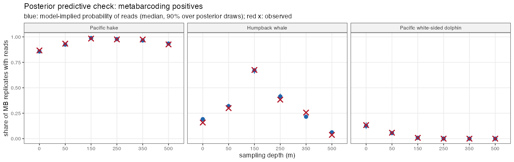

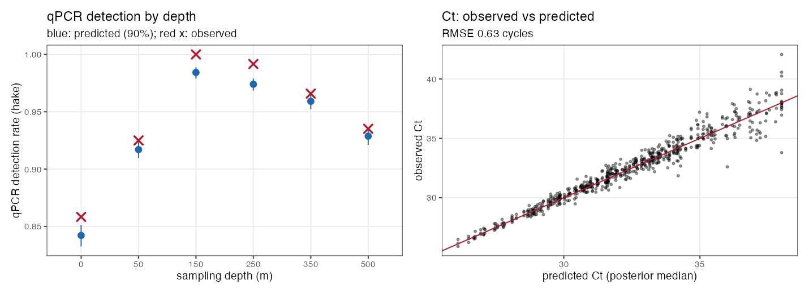

- **Metabarcoding.** The depth profiles of the share of replicates with reads, which
  are the depth preferences, are reproduced for all three species: hake is nearly
  always positive, humpback peaks at 150 m, PWSD falls to zero below 150 m.
- **qPCR.** Detection rates by depth follow the observed shape, but the model
  predicts 1 to 2 percentage points fewer detections than observed at every
  depth, a small, consistent under-prediction. Ct is predicted with an RMSE of
  0.63 cycles; the largest errors are at the highest Cts, where the observed
  values are lower than predicted.

> **[REVIEW] Upstream gap.** The metabarcoding posterior predictive draws in
> HSGP4eDNA's generated quantities (`pp_mb_reads`) leave out the zero-inflation
> term that the likelihood contains, so they predict reads for essentially every
> replicate. The metabarcoding check above therefore computes the probability of
> any reads directly from posterior draws, using the likelihood's own formula.
> Adding the zero-inflation step to the generated quantities in HSGP4eDNA would fix
> this at the source; I did not change that repository.

### What HSGP4eDNA's validation adds

For context, the upstream validation of the same structure (3 chains of 800 + 800,
v1.3 defaults):

| Scenario fitted with 2-D HSGP + spline | N | Runtime | Divergences | max Rhat | Field R² (hake / humpback / PWSD) | Hyperparameters covered |
|---|---|---|---|---|---|---|
| `bathysp_surface` (matched) | 200 | 49 min | 0 | 1.01 | 0.98 / 0.59 / 0.74 | 12 of 12 |
| `bathysp_depthspref` (matched) | 1185 | 924 min | 0 | 1.01 | 1.00 / 0.94 / 0.76 | 12 of 12 |
| `bathygp_surface` (mis-specified: depth inside a GP) | 200 | 123 min | 0 | 1.30 | 0.70 / 0.81 / 0.76 | n/a, not converged |

The last row matters: when the truth is not a spline in bottom depth, the model
**says so**. Chains disagree (Rhat 1.30), the hake length-scales fall below the
prior floor, and $\theta$ collapses to 2.8. Mis-specification is detectable without
knowing the truth.

## Test on real data

**What is available.** *The fit in this section used the first eDNA files:*
551 bottles at 182 stations and 19 distinct sampling depths (172 at the surface,
then mostly 50, 150, 300 and 500 m), 2663 hake qPCR replicates and 1709
metabarcoding replicates.

**The current real eDNA data (2026-10-22; not yet fitted).** The loader now
builds the eDNA object from the qPCR lab's analysis-A file, the compiled
MarVer1 taxon table and the 2019 sample metadata, matched on sample number
(`notes/muri_data_formatting.md`, "eDNA from the lab files"):

| | |
|---|---|
| Bottles / stations | 513 / 167 (30EtOH samples, 56 of 569, dropped for now: a lab mix-up lost about 20–30% of their DNA) |
| Sampling depth | target depth `depth_cat`: 0, 50, 150, 300, 500 m (169, 146, 65, 67, 66 bottles); recorded depth is within 36 m of it |
| Bottom depth | the metadata's consensus bottom depth (the lab's recommendation) |
| Hake qPCR | 1,532 wells on 25 plates, Ct as provided (cleaned by the lab: one dilution per sample, no inhibited wells); 86% detections |
| Standard curves | per plate, fitted to the 659 non-inhibited hake standards on 33 plates (`stan/qpcr_standards.stan`, after the qPCR vignette): intercepts 36.1–39.9, slopes 1.45–1.49 Ct per log copy (efficiency 0.95–1.00), $\kappa$ = 0.90 |
| Metabarcoding | MarVer1, per bottle the dilution with the most reads; replicates with fewer than 1,000 reads dropped as failed PCRs; 1,302 replicates in 500 bottles (13 bottles qPCR only) |
| Dilutions | log offsets per qPCR well (1 or 1:5) and per metabarcoding replicate (1 to 100-fold) |
| Volumes | filtered volume per bottle (2.5 L for 511); template 2 µL per reaction for both assays (confirmed); elution 100 µL (assumed) |
| Contamination | *Gallus* reads removed from junk and totals; hake detected in field negatives, used as provided on the lab's advice |
| Amplification | MarVer1 amplifies hake, humpback and PWSD equally (confirmed), so no efficiency term is needed |

The model side is ready: HSGP4eDNA v1.8–v1.12 (the submodule since
2026-10-23) and the joint model (since 2026-10-23) take the per-plate curves
estimated from the standards, the dilution offsets, the per-bottle volumes and
the sampling-depth smooth. **The real eDNA fit with them is running** (the
joint model's eDNA-only mode, `R/fit_joint_real.r`, on the stats3 server); the
fit shown further below is the earlier one, without them.

**The hake standard curves on their own.** Before estimating them inside the
model, the per-plate curves were fitted to the standards alone
(`R/fit_qpcr_standards.r`, `stan/qpcr_standards.stan`: the vignette's
multi-plate model and priors; 4 chains of 1000 + 1000, no divergences, max
R-hat 1.003). 765 hake standard wells (1 to $10^5$ copies per µL) are on the
33 plates; 106 with inhibition ≥ 0.75 are dropped, among them every $10^5$
standard, which leaves 659 (26 non-detects).

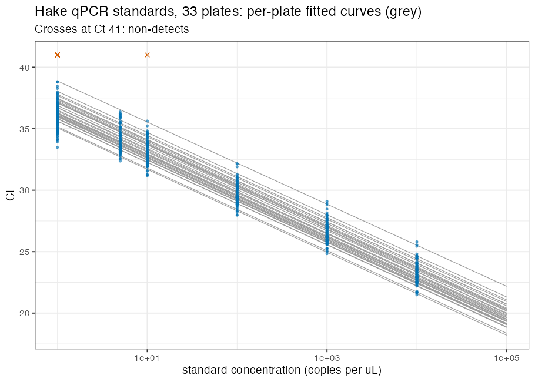

| | Estimate |
|---|---|
| Intercepts $\alpha_p$ (Ct at 1 copy in the well) | 36.1–39.9 across plates |
| Slopes $\beta_p$ (Ct per log copy) | 1.45–1.49, efficiency 0.95–1.00 (1 = doubling) |
| Detection rate $\kappa$ | 0.90 [0.75, 1.00] |
| Ct noise | $\sigma_0$ 0.14; $\gamma_0$ 0.26, $\gamma_1$ −0.37 (more noise at low copies) |
| Check: detected standards inside their 95% predictive interval | 97.0% |
| Check: detection at 1 copy per µL, observed against fitted | 0.865 against 0.836 |

- The intercepts differ by almost 4 Ct between plates, a factor of about 15
  in copies, so a single shared curve would misplace plates' samples; hence
  per-plate curves.
- **Field negatives:** hake is detected in 73 of 114 evaporated-DI and 25 of
  72 lab-DI field-negative wells (about 1–2 copies per µL on average, up to
  12), against 1 of 174 extraction controls. The lab advises using the data as
  provided; Section 6 lists what this means for the cetacean estimates.

**What is not.** The qPCR file holds copies per $\mu$L, not Ct, and there is no
standard curve (slope, intercept, detection efficiency $\kappa$, Ct noise). The
model's qPCR part is built on Ct, so **it cannot be fitted yet**. Volumes filtered,
aliquot and elution volume are also missing, and the eDNA files carry no dates.
*(Update, 2026-10-21: the qPCR lab's file with Ct per well, the hake standards on
all 33 plates, the filtered volume per bottle and the dates has since arrived,
with a new metabarcoding table and metadata. The loader now uses them: 513
bottles, Ct for 1,532 hake wells, per-plate standard curves fitted to the
standards, dilutions and target depths; `notes/muri_data_formatting.md` and
ROADMAP_2026-10-21, section 5. This fit was made before that and has not been
re-run.)*

**What I did.** The model was fitted to metabarcoding only: all qPCR rows were
dropped except one non-detect (the model's data block requires at least one), the
water-column offset was set to 1 for all bottles, and the conversion factors and
volumes are the simulator's placeholders. So the fit says **where relative
density is high**, not how many animals there are.

The fit used 2 chains of 400 + 400 iterations and a basis of 399 functions (7 by
57; the design prior stretches the basis along the coast because the 551 bottles
lie in a long thin band).

| | |
|---|---|
| Bottles / metabarcoding replicates | 551 / 1709 |
| Runtime (2 chains) | 247 min |
| Divergences / max-treedepth hits | 0 / 0 |
| max Rhat / min bulk ESS | 1.02 / 80 |
| E-BFMI per chain | 0.41, 0.49 |
| Bottle-noise $\theta$ (median, 90% interval) | 0.24 [0.21, 0.26] |
| Junk-noise $\theta_\text{junk}$ | 0.65 [0.57, 0.74] |

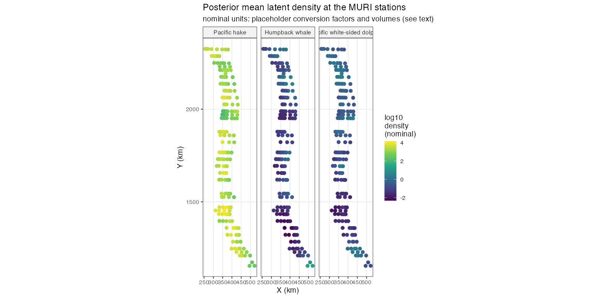

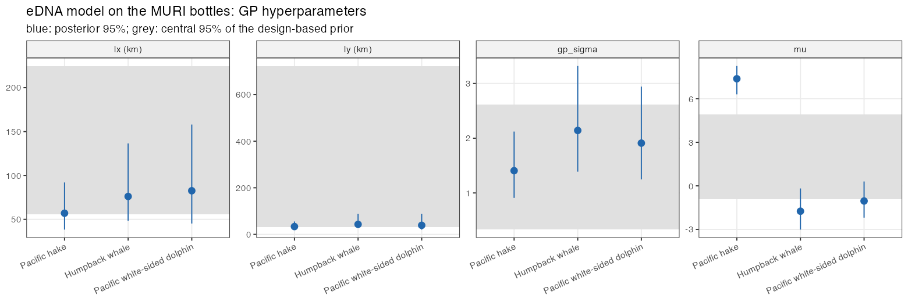

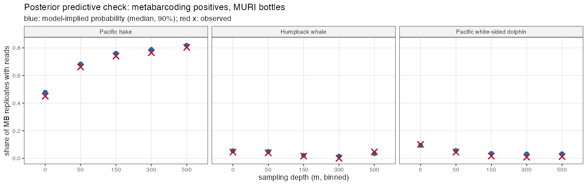

**What the checks say.**

- **The model reproduces the observed read frequencies.** For all three species and
  all depth classes the observed share of replicates with reads is inside, or within
  about a percentage point of, the predicted interval. The one visible miss is
  humpback at 300 m: none of 234 replicates had reads, against about 3.7 expected.
  This is an in-sample check, and with free per-bottle noise terms it is easy to
  pass.
- **The noise terms are very large.** $\theta$ = 0.24 means a coefficient of
  variation of about 2 in the bottle-to-bottle multiplier; on matched simulations
  $\theta$ is about 9 (truth 10). HSGP4eDNA documents a $\theta$ far below its
  matched value as a sign that the noise terms are absorbing structure the model
  lacks (its mis-specified example read 2.8).
- **The length-scales are short and at the floor.** The along-coast length-scale is
  about 34 to 43 km against a prior floor of 27 km, and `floor_check()` flags
  all six species-axis combinations (the posterior puts 16 to 65% of its mass within
  1.25 $\ell_\min$, against 3 to 6% under the prior).
- **Sampling is thin.** The minimum bulk ESS of 80 and E-BFMI near 0.4 come from
  only two chains.

> **[REVIEW] How to read this fit.** I would not interpret the map or the
> hyperparameters yet. Several things the data have and the model does not, each
> of which could push variation into the noise terms and the short length-scales:
> the 19 sampling depths are treated as one (offset 1), whereas the simulations
> show how strongly depth shapes eDNA; the metabarcoding replicates were run at
> template dilutions from 1 to 100-fold; the qPCR information (the most
> informative data for hake) is absent; and the conversion factors and volumes are
> placeholders. The honest summary is that the model **runs on the real bottles
> and reproduces their read frequencies**, and that the diagnostics point to
> structure it does not yet represent.

> **[REVIEW]** Open decisions before the real eDNA fit is more than a sanity check:
> which qPCR wells to use and how to treat late Ct values and flagged samples
> (the Ct values and standards have now arrived; `docs/dataQs.md`); per-bottle
> volumes, which vary for a few bottles (the model takes one value); and how to
> treat the 19 sampling depths (a modelling choice: offset, covariate, or
> separate surfaces).

# The visual (distance sampling) spatial model

## Background: what a line-transect analysis does

On a line transect, animals close to the line are nearly always seen and animals
far away are often missed. A **detection function** $g(x)$ describes the
probability of detection at perpendicular distance $x$. Integrating it gives the
**effective strip half-width** (ESW): a strip of that half-width with perfect
detection would see the same number of animals. Density follows from counts
divided by $2 \times L \times \text{ESW}$.

A traditional analysis (for example Len Thomas's CalCOFI analysis, which we
followed) makes these choices, and so does our model:

| Choice | Traditional practice | Our model |
|---|---|---|
| Truncation | Drop the largest 5 to 10% of distances, per species | 95th percentile per species |
| Key function | Half-normal or hazard-rate, by AIC, with caution for species that bow-ride | Half-normal; **hazard-rate option** (used for humpback on real data) |
| Covariates | Group size, Beaufort, swell, observer platform; chosen by AIC | Group size and Beaufort; chosen by AIC on this data set |
| Size bias | Larger groups are seen farther away; correct for it | Group-size distribution is modelled and size-bias corrected |
| g(0) | Often corrected for animals missed on the line | **Assumed 1** (a limitation) |
| Spatial model | Often none | 2-D HSGP + bottom-depth spline on log density |

## Structure of the visual model

The model is `stan/hsgp_visual.stan`, one species at a time:

- **Field:** $\log\lambda = \mu + f(X,Y) + B(Z)\beta$, the same structure and units
  as the eDNA model, so the two can share it.
- **Encounters:** segment counts are Poisson with mean
  $\lambda / E[s] \times 2L \times \text{ESW}$, or, with `use_nb`, negative
  binomial with the same mean and size $\phi$ (variance $\mu + \mu^2/\phi$;
  prior half-normal(0, 1) on $1/\sqrt\phi$). A gamma-distributed multiplier on
  the groups in a segment's strip, thinned by detection, gives exactly this.
  **$1/\sqrt\phi$ is bounded below at 0.01** ($\phi \le 10^4$, which is
  Poisson for these counts; added 2026-10-25): without the bound, chains on
  near-Poisson sightings drifted towards $\phi = \infty$, where $\phi$
  overflowed and the sampler stalled (a visual-only fit stuck for over 8 hours;
  73 minutes with the bound).
- **Distances:** truncated half-normal or hazard-rate detection with
  $\log\sigma = \log\sigma_0 + \beta_\text{size}(s - \bar s) + \beta_\text{bft}(\text{Beaufort} - 3) + \beta_\text{vis}(\text{visibility} - 6)$.
  This is Distance's log-scale form, $\sigma = \exp(\beta_0 + \beta_1 x_1 +
  \dots)$; the covariates are centred at reference values, which changes only
  what the intercept means (the scale at Beaufort 3, the mean group size and
  visibility 6 nmi). The hazard-rate shape $b$ is not yet bounded below at 1
  (Section 6).
  Beaufort and visibility are segment means. Segments are grouped into
  detection-condition cells (Beaufort and visibility each rounded to 0.5, the
  recording resolution), and the ESW is computed once per cell.
- **Switches:** each covariate and the NB counts are switched per species; with
  a switch off the model is exactly the model without it (checked on log
  densities at random parameter values, `tests/joint_exactness.R` and
  `tests/visual_nb.R`).
- **Group sizes:** zero-truncated negative binomial (humpback) or log-normal
  (PWSD), with the size-bias correction.
- **Priors:** the same design-based GP priors as the eDNA model, built from
  segment locations only.


## Group size: where it comes from, how it enters, and how it is biased

Group size matters twice in a line-transect model. It sets how many animals sit
behind each detected *group*, and (when larger groups are easier to see) it changes
how far out a group is detected. Both go through one parametric distribution of
group sizes and the effective strip half-width.

### Where the group sizes come from

| Stage | Source |
|---|---|
| **Real data** | The observers' best estimate of group size (`gsspbest`) for each *detected* group: on effort, with a perpendicular distance, within the truncation distance |
| **Simulator truth** | The empirical pools in `data/grpsz/` (all of the survey's sightings of the species: 683 humpback, 110 PWSD), resampled **as the population** of groups present |
| **Model** | A parametric population distribution fitted to the detected sizes: zero-truncated negative binomial (humpback) or log-normal (PWSD), on sizes $1,\dots,S_\max$ |

### How group size enters the model

Let $p_k$ be the population probability of a group of size $k$, and let
$\sigma_k$ be the detection scale for such a group in sea state $b$:

$$
E[s] \;=\; \sum_{k=1}^{S_\max} k\,p_k ,
\qquad
\sigma_k \;=\; \sigma_0\, e^{\beta_\text{size}(k-\bar s)}\, e^{\beta_\text{bft}(b-3)} ,
\qquad
\text{ESW}(\sigma_k) \;=\; \int_0^w g(x \mid \sigma_k)\,dx .
$$

The strip width is **averaged over the population of group sizes**, not evaluated at
the average size:

$$
\overline{\text{ESW}}(b) \;=\; \sum_{k=1}^{S_\max} p_k \,\text{ESW}\big(\sigma_k(b)\big).
$$

Segment counts then follow

$$
E[\text{detected groups}_j] \;=\; \frac{\lambda_j}{E[s]} \;\times\; 2L_j \;\times\; \overline{\text{ESW}}(b_j),
$$

where $\lambda_j$ is animal density (animals per km²), so $\lambda_j / E[s]$ is the
density of *groups*. Each detected group contributes its distance $x_i$ and size
$s_i$ through

$$
p(x_i, s_i \mid \text{detected}) \;=\; \frac{g(x_i \mid s_i)\, f(s_i)}{\overline{\text{ESW}}(b_i)},
$$

so the sizes of detected groups inform both the population distribution $f$ and the
size effect $\beta_\text{size}$.

**Segments with no detections.** $\overline{\text{ESW}}$ does not use a segment's own
detections. It depends only on the segment's covariate level (its binned Beaufort,
where used) and on the global parameters ($\sigma_0$, $\beta_\text{size}$,
$\beta_\text{bft}$, the hazard-rate shape, the group-size parameters). All segments
at the same sea-state level share the same value, whether or not anything was seen,
and a zero count is evidence of low density in proportion to that expected count.

**Without a size effect on detection** ($\beta_\text{size}$ off), $\text{ESW}(\sigma_k)$
is the same for every $k$, group size drops out of the strip width, and
$E[s]$ is simply the mean of the detected sizes (the model has no way to know
detected groups are unrepresentative).

**With a size effect**, larger groups have a wider strip, so the *detected* groups
have a mean size above the population mean:

$$
\text{mean size of detected groups} \;=\; \frac{\sum_k k\,p_k\,\text{ESW}_k}{\sum_k p_k\,\text{ESW}_k} \;>\; E[s],
\qquad
\text{effective strip width per animal} \;=\; \frac{\overline{\text{ESW}}}{E[s]} .
$$

The model estimates $E[s]$ from the detected sizes by undoing that weighting.

*Implementation.* The sum over $k$ is binned (sizes 1 to 30 individually, then 10%
log bins; it agrees with the full sum to about $10^{-5}$), the hazard-rate integral
is a 400-cell midpoint rule, and the half-normal integral is closed-form.

### Is it biased?

Yes, in several ways. The first three are the important ones.

| Source of bias | What happens | Handled? |
|---|---|---|
| **Size-biased detection** | Larger groups are seen farther out, so detected groups over-represent large ones | Only through $\beta_\text{size}$, and only if that term is in the model and its log-linear form is adequate (an extrapolation for the largest dolphin schools) |
| **No size effect assumed** | If $\beta_\text{size}$ is off, $E[s]$ equals the detected mean by construction | Not corrected; use the size effect where the data support it |
| **Simulator truth is a detected sample** | The pools are made of detected groups, then used as the population | Simulation tests consistency, not realism |
| **Observer error** | Best estimates of large schools are rough and rounded; "groups" can be subgroups | Not modelled; enters $E[s]$ one-for-one |
| **One distribution everywhere** | Mean group size is global, so spatial variation in group size is absorbed into the density surface | Not modelled |
| **Tail of the log-normal** | The PWSD support runs to 1000 against a largest observed group of 452 | Sensitivity check below |
| **Missing sightings** | 73 on-effort sightings have no perpendicular distance and are excluded | If missingness relates to size, biased |

Because density is group density times $E[s]$, any bias in $E[s]$ is a bias in
animal density of the same proportion.

### What the real-data fits show

Four fits on the current set-up (north of 35°N, 1641 segments, 792-function basis,
2 chains of 500 + 500, no divergences, max Rhat at most 1.01):

| | Humpback, no size effect | Humpback, with size effect | PWSD, $S_\max$ = 1000 | PWSD, $S_\max$ = 500 |
|---|---|---|---|---|
| Detections | 548 | 548 | 89 | 89 |
| Mean size of detected groups | 1.70 | 1.70 | 46.6 | 46.6 |
| Mean size within 1 km of the line | 1.56 (n = 180) | 1.56 | 37.4 (n = 39) | 37.4 |
| Model population mean $E[s]$ (90% interval) | 1.70 [1.63, 1.78] | 1.69 [1.61, 1.78] | 37.0 [29.7, 47.5] | 36.5 [29.2, 45.1] |
| $\beta_\text{size}$ (90% interval) | at prior (off) | 0.029 [$-0.043$, 0.101] | 0.0041 [0.0009, 0.0128] | 0.0039 [0.0011, 0.0123] |
| Mean animal density (per km²) | 0.0227 | 0.0225 | 0.093 | 0.093 |
| Mean detection probability | 0.44 | 0.44 | 0.51 | 0.50 |
| Runtime (2 chains) | 13 min | 18 min | 24 min | 22 min |

- **PWSD has a clear size bias, and the model corrects it.** The detected groups
  average 46.6 animals, but the population mean is estimated at 37.0, a correction
  of about $-21\%$. An independent check agrees: groups seen within 1 km of the
  line, where detection is nearly certain regardless of size, average 37.4. Beyond
  3 km the mean is 74 (n = 13). Without the correction PWSD density would be about
  26% too high.
- **The tail does not matter much.** Cutting the support from 1000 to 500 changes
  $E[s]$ by $-1.3\%$ and density by $-0.5\%$.
- **Humpback has little size bias to correct.** Groups are mostly singles. With the
  size effect on, $\beta_\text{size}$ is 0.029 with an interval that includes zero,
  $E[s]$ moves by $-1\%$ and density by $-0.8\%$. The data are not informative about
  it (548 detections, most of size 1 or 2); the near-line mean is a little lower
  than the model's (1.56 against 1.69), within sampling noise at this sample size.

> **Correction.** The AIC selection for humpback picked a group-size effect on
> detection ($\Delta$AIC $-3.2$), and the notes and the real-data tables in this
> document describe humpback as "hazard-rate, group size". The earlier real-data
> humpback fits did **not** include it: the loader never switched
> `use_size_covar` on for humpback (the simulator's humpback truth has none). The
> loader now sets it, and the processed objects are regenerated. The comparison
> above shows the omission changed humpback's mean group size and density by about
> 1%, so the earlier numbers stand to that accuracy. (All the real-data results
> above this point in the document also predate the 35°N set-up.)

## Test on simulated data

**Setup.** One survey (seed 1): 25 transects of 10 km segments, 549 humpback and
78 PWSD detections within 5 km. Basis of 392 functions (28 by 14, set by the
design-based prior rule); 3 chains of 800 + 800 iterations.

| | Humpback | PWSD |
|---|---|---|
| Detections | 549 | 78 |
| Runtime (3 chains) | 4.9 min | 14.4 min |
| Divergences / max-treedepth hits | 0 / 0 | 0 / 0 |
| max Rhat / min bulk ESS | 1.004 / 313 | 1.005 / 778 |
| Latent-field R² at the segments | 0.92 | 0.70 |

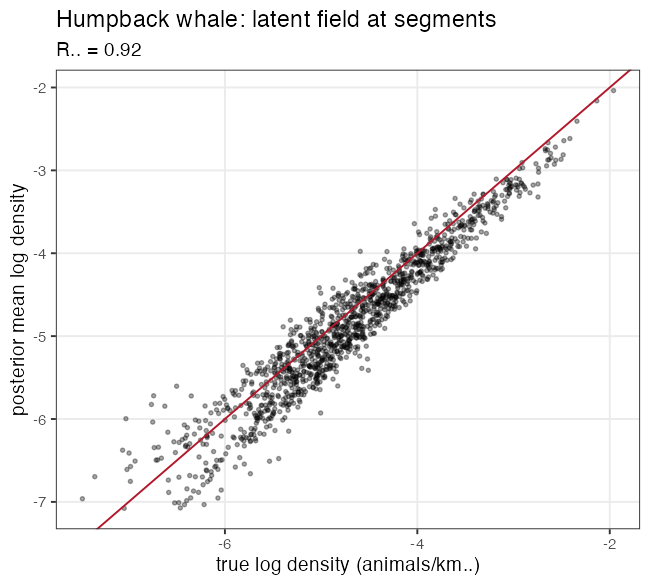

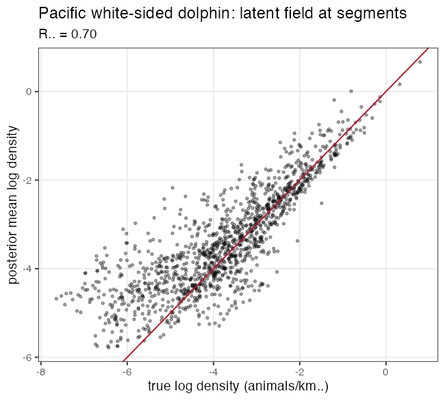

**Recovery of the parameters** (posterior median and 95% interval):

| Quantity | Humpback truth | Humpback posterior | PWSD truth | PWSD posterior |
|---|---|---|---|---|
| Detection scale $\sigma$ (km) | 2.5 | 2.63 [2.40, 2.93] | 1.5 | 1.20 [1.02, 1.46] ✗ |
| Mean density (per km²) | 0.0136 | 0.0121 [0.0107, 0.0137] | 0.061 | 0.082 [0.060, 0.111] |
| $\ell_x$ (km) | 50 | 43 [30, 82] | 50 | 56 [34, 83] |
| $\ell_y$ (km) | 300 | 274 [206, 364] | 300 | 286 [159, 463] |
| GP marginal SD | 1.0 | 0.97 [0.73, 1.44] | 1.3 | 1.37 [0.90, 2.14] |
| Mean group size | 1.72 | 1.71 [1.64, 1.80] | 42.7 | 40.3 [31.5, 52.9] |

Eleven of twelve intervals contain the truth. The miss is PWSD's detection scale,
just outside its interval (1.46 against a true 1.5), which also happened in one of
the five replicates in the repository's validation study.

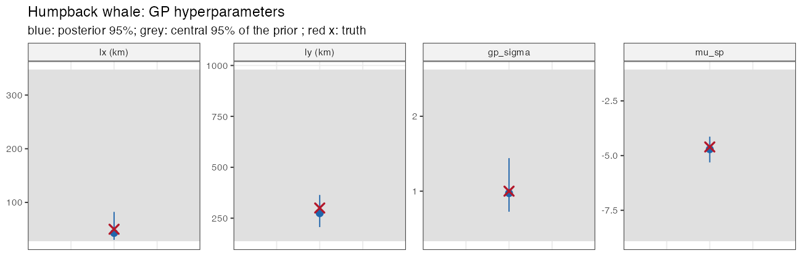

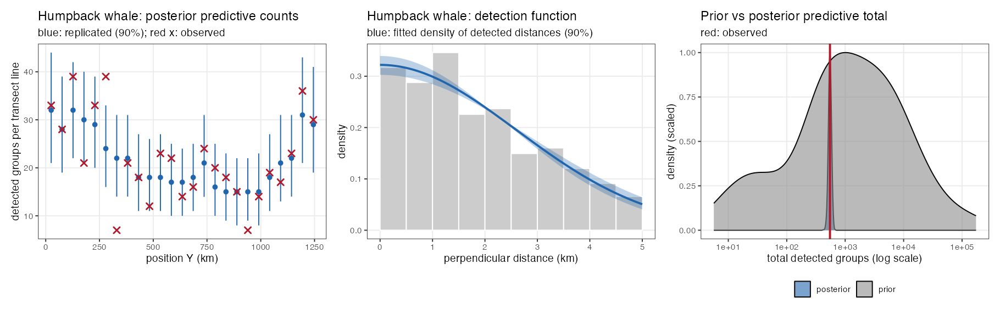

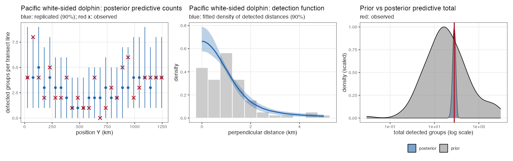

**Reading the checks.**

- **Counts.** The observed number of detections per transect line sits inside the
  replicated 90% interval for nearly every line (about 90% by construction, so a
  few misses are expected).
- **Detection function.** The fitted curve follows the histogram of detected
  distances, and the bars nearest the trackline are the tallest, as a
  half-normal predicts. (Histograms in this document start their first bin at
  zero. An earlier version let the plotting default centre a bin on zero, which
  halves the first bar and looks like a deficit of detections near the line; the
  counts themselves, 87 in the first 0.5 km for humpback against 91 expected,
  were never short.) For PWSD (78 detections) the first two bars sit above the
  curve, within the noise of a small sample.
- **Prior against posterior.** The priors alone imply anywhere from tens to
  hundreds of thousands of detected groups, so they are weak. The data then
  collapse that to a narrow range around what was observed.
- **Hyperparameters.** All posteriors sit well inside the prior band, so the
  data, not the prior, determine them. The east-west length-scale ($\ell_x$) is
  the least certain parameter for both species.

### Replicated validation

The repository's multi-replicate study (5 simulated surveys, 4 chains of 1000 +
1000, design-based priors) gave:

| Species | Detections | Divergences | max Rhat | Field R² | Coverage of density, $\sigma$, group size | Coverage of GP SD, $\ell_x$, $\ell_y$ |
|---|---|---|---|---|---|---|
| Humpback | 549 to 917 | 0 in 5 fits | at most 1.01 | 0.87 to 0.93 | 5/5, 5/5, 5/5 | 5/5, 5/5, 5/5 |
| PWSD | 41 to 100 | 1 each in 2 fits | at most 1.00 | 0.60 to 0.79 | 5/5, 4/5, 5/5 | 5/5, 4/5, 5/5 |

With sea state simulated (3 replicates), fitting without the Beaufort covariate
reads poor sighting conditions as low density: the fitted field shifts by up to
0.58 log units across the survey. The covariate recovers its true effect in 3 of 3
fits.

The visibility covariate is checked the same way (`tests/visual_detection.R`):
on a simulation with Beaufort and visibility, the PWSD-like fit recovers
$\beta_\text{vis}$ = 0.18 [0.13, 0.23] (99% interval; truth 0.2), and the ESW
per detection-condition cell agrees with numerical integration to 2e-5.

### Clustered sightings and the length-scale floor (35°N)

The real fits (Section 4.5) put the GP length-scales at the prior **floor**:
the shortest scale the basis can represent, about 42 km east-west by 65 km
north-south for the 800-function budget on the 35°N effort. One possible cause
is clustered sightings: counts more variable between segments than Poisson
allows, which a Poisson model can only fit by making the field wiggly. This was
tested by simulating sightings on the **real 35°N effort** from a field with
length-scales of 150 × 250 km (well above the floor), with Poisson or
negative-binomial counts per segment (`R/check_count_dispersion.r`, seed 1,
4 chains of 500 + 500; `notes/count_dispersion_check.md`).

| Sightings (humpback) | Variance / mean | Model | Length-scales (km) | Floor flags | Field R² | NB size $\phi$ |
|---|---|---|---|---|---|---|
| Poisson | 1.20 | Poisson | 171 × 207 | none | 0.89 | |
| Poisson | 1.20 | NB | 173 × 212 | none | 0.89 | about 100 |
| NB, size 1 | 1.60 | Poisson | 130 × 254 | none | 0.83 | |
| NB, size 0.3 | 3.35 | Poisson | **48 × 92** | **both** | **0.65** | |
| NB, size 0.3 | 3.35 | NB | 131 × 163 | none | 0.83 | 0.31 [0.24, 0.40] |
| **Real data** | 2.5 | NB | **35 × 50** | **both** | | 2.9 [1.8, 5.6] |

PWSD gives the same pattern (size 0.3: Poisson model 80 × 139 km and flagged,
NB model 115 × 267 km; $\phi$ recovered as 0.30).

- **Strong clustering does make a Poisson model follow the floor,** and the NB
  term removes it, recovering the clustering. Moderate clustering (size 1)
  does neither. The NB model is harmless on Poisson data.
- **The real data are different:** the NB model finds moderate overdispersion
  (humpback $\phi$ ≈ 2.9, PWSD ≈ 1.1, the range where the simulations show no
  floor-following), and the length-scales stay at the floor. So the real
  floor-following is not explained by clustering that is independent between
  segments; the real fields seem to vary on scales of about 30 to 50 km or less
  (or the clustering is correlated over several segments, which the model
  cannot tell apart from fine-scale density). NB counts are on by default for
  both cetaceans on the real data.

## Real data: the MURI line-transect survey

**Data.** The 2018 CCES cruise: 2779 effort segments of about 5 km (12,967 km of
effort), with sightings of humpback and PWSD. *(Now restricted to north of
35°N and to Beaufort ≤ 5: 1617 segments, 7,441 km, with 547 humpback and 89
PWSD detections within the truncation distances. The first fits below used all
the effort; Section 4.5.2 has the 35°N fits.)* Perpendicular distances come from
the survey's own records (`SITEINFO_CCE_2018_Pp_Lo_Mn.csv`; km). **Visibility**
is the observers' estimate of the distance, in nautical miles, at which a
dolphin could be seen surfacing against the water (SWFSC DAS format, weather
event "W"); segment means run from 1 to 7.5 nmi (median 6), in 0.5 nmi steps.

**Decisions made along the way** (all in `notes/muri_data_formatting.md`):

| Decision | Choice |
|---|---|
| Truncation | 95th percentile per species: humpback 6.45 km, PWSD 4.64 km (548 and 89 detections kept; 6.46 km and 547 after the Beaufort cut) |
| Detection key | Humpback hazard-rate (about 20 AIC points better than half-normal); PWSD half-normal |
| Covariates | Humpback: group size (selected by AIC; see the correction in Section 4.3). PWSD: group size and Beaufort in the first fits; **visibility added 2026-10-22** (the AIC selection on the 35°N effort: visibility −6.8, Beaufort −1.9, group size −1.2 AIC) |
| Sea state | **Beaufort ≤ 5** (2026-10-22): 24 segments (120 km) and one humpback sighting dropped; the usual line-transect limit |
| Segment counts | Poisson in the first fits; **negative binomial** for both species from 2026-10-22 (Section 4.4.2) |
| Domain | Bounding box of all effort and eDNA, 1360 by 2600 km; now the 35°N study domain, 690 by 1770 km |
| Sightings without a distance | Excluded (69 humpback, 4 PWSD) |

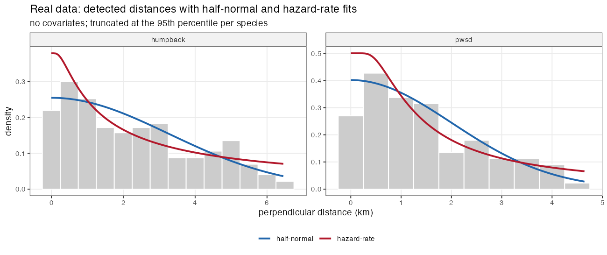

### Fit to the real data

Both species were fitted with the spatial model on all 2779 segments (basis of 391
functions, 2 chains of 500 + 500, design-based priors built from the segment
locations). These are single fits, shorter than the validation runs, and should
be read as a working demonstration rather than a final analysis.

| | Humpback | PWSD |
|---|---|---|
| Detection function | hazard-rate, group size | half-normal, group size and Beaufort |
| Detections used | 548 | 89 |
| Runtime (2 chains) | 25 min | 31 min |
| Divergences / max-treedepth hits | 0 / 0 | 0 / 0 |
| max Rhat / min bulk ESS | 1.008 / 387 | 1.004 / 459 |
| Mean density (animals per km², 90% interval) | 0.0135 [0.011, 0.016] | 0.056 [0.041, 0.075] |
| Mean group size | 1.71 [1.64, 1.79] | 37.9 [30.1, 47.6] |
| Detection-function shape | $b$ = 0.96 [0.77, 1.19] | Beaufort effect $-0.12$ per unit [$-0.29$, $0.006$] |
| $\ell_x$, $\ell_y$ (km, medians) | 80, 113 | 86, 128 |
| GP marginal SD (median) | 3.6 | 2.9 |

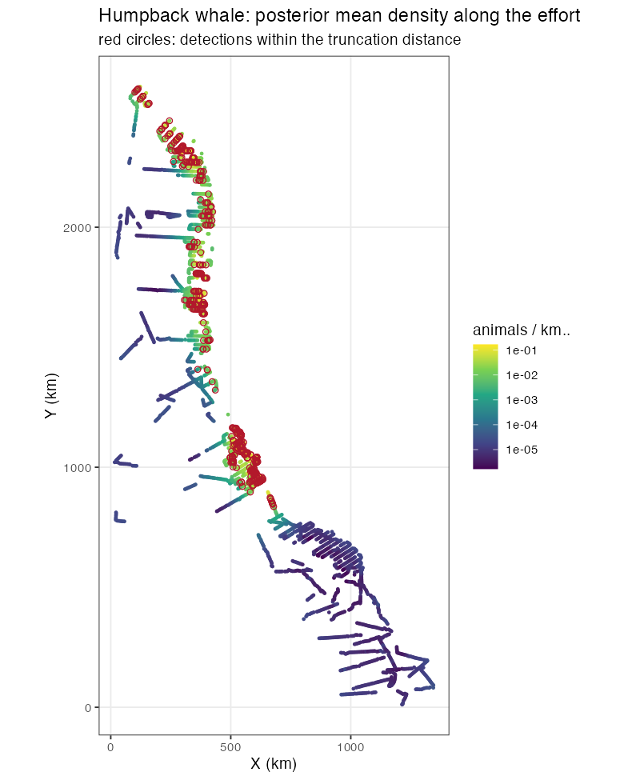

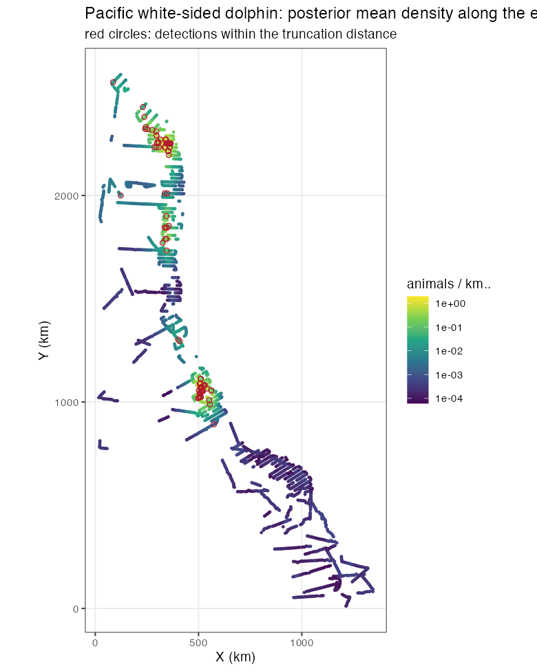

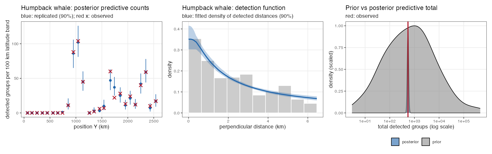

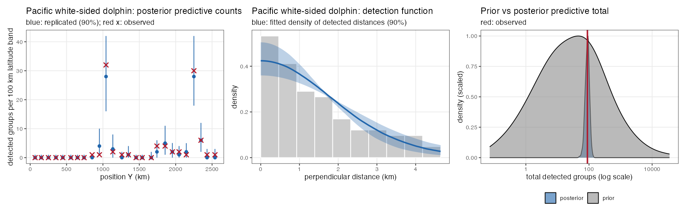

**Reading the checks.**

- **Counts.** Observed counts per 100 km latitude band fall inside the replicated
  90% intervals almost everywhere for both species, including the sharp contrast
  between the empty south (Y below about 800 km, southern California and further
  south) and the dense regions near central California (Y of about 1000 km) and
  from southern Oregon to Vancouver Island (Y of about 1700 to 2400 km).
- **Detection function.** For humpback the fitted hazard-rate curve passes through
  the tallest bars near the trackline and then falls away with a long tail,
  which is the shape the half-normal could not reproduce (see the detection-key
  comparison above); the
  90% band is widest near zero, where few detections constrain it. For PWSD the
  fit tracks the histogram.
- **Prior against posterior.** As on simulated data, the priors are weak and the
  data narrow the predicted total to the observed value.

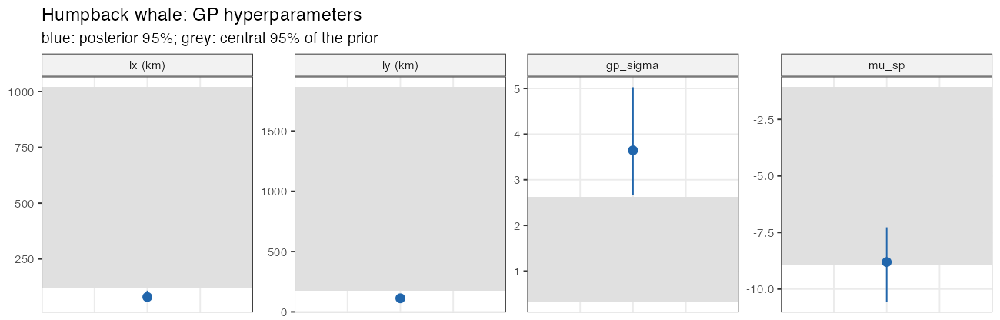

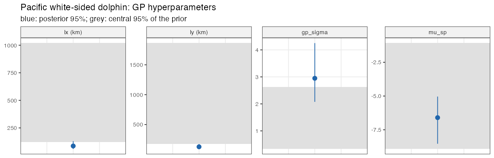

**Refit at twice the basis budget.** The check below flagged the first fits, so both
species were refitted with `M_max` = 800 (a basis of 792 functions; the floor
$\ell_\min$ falls to 75 km east-west and 106 km north-south). Neither fit had divergences
(max Rhat 1.005 and 1.004).

| | Humpback, 391 functions | Humpback, 792 functions | PWSD, 391 functions | PWSD, 792 functions |
|---|---|---|---|---|
| Runtime | 25 min | 42 min | 31 min | 54 min |
| Mean density (per km², 90% interval) | 0.0135 [0.0113, 0.0162] | 0.0135 [0.0112, 0.0161] | 0.056 [0.041, 0.075] | 0.057 [0.041, 0.077] |
| Mean group size | 1.71 | 1.71 | 37.9 | 37.7 |
| Detection shape / Beaufort effect | $b$ = 0.96 | $b$ = 0.97 | $-0.12$ | $-0.10$ |
| $\ell_x$, $\ell_y$ (km, medians) | 80, 113 | 58, 85 | 86, 128 | 64, 93 |
| Floor $\ell_\min$ (km) | 106, 150 | 75, 106 | 106, 150 | 75, 106 |
| Floor check flags | both axes | both axes | both axes | both axes |
| GP marginal SD (median) | 3.6 | 3.6 | 2.9 | 2.8 |


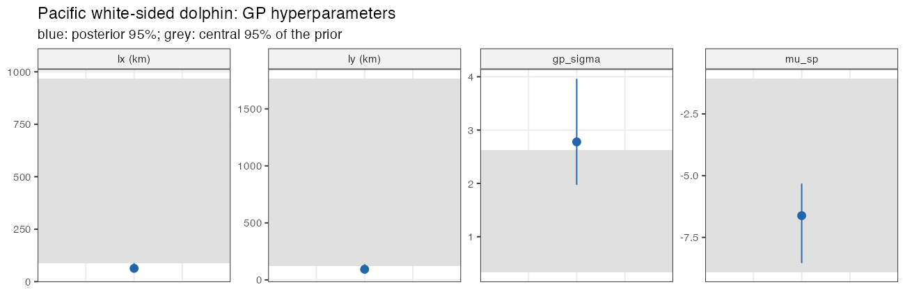

> **[REVIEW] The length-scale posteriors track the floor, and density does not
> depend on it.** At both budgets `floor_check()` flags both axes of both species:
> the posterior length-scales (58 to 128 km) lie below the floor ($\ell_\min$ = 75 to
> 150 km), and doubling the basis lowered the floor and the posterior with it
> (humpback $\ell_x$ 80 to 58 km). So a larger basis alone does not make the flag
> go away. Density, detection and group-size estimates did not change (mean
> humpback density 0.0135 both times; PWSD 0.056 and 0.057). Two things are
> consistent with this pattern, and I have not separated them: real
> sightings are more clustered than a smooth GP with Poisson counts allows, so
> the GP uses short length-scales to chase hot spots (the same mechanism that
> HSGP4eDNA documents for unmodelled bottle noise); or the real field really
> has structure on scales of tens of kilometres. The visual model has no
> overdispersion term for segment counts. The marginal SD is also above the
> prior's central 95% (upper bound 2.7) in all four fits. *(Resolved
> 2026-10-22, Sections 4.4.2 and 4.5.2: clustering does not explain it, the
> pattern holds on the 35°N data, and the decision is to keep the 800 budget
> and read the flag as a resolution limit of the basis.)*

> **[REVIEW]** The real-data effort extends well beyond the eDNA region: eDNA
> bottles cover about 20% of the width and 45% of the height of the domain.
> *(On the 35°N study domain they cover about 39% of the width and 66% of the
> height.)* A
> visual-only fit is informative everywhere; a joint fit will only borrow
> strength in the eDNA region.

### Fits on the 35°N data, with NB counts and visibility (2026-10-22)

`R/fit_visual_real.r`, 4 chains of 1000 + 1000 unless noted. **The current
fits** are on the Beaufort ≤ 5 effort (1617 segments) with the stored settings:

| Species, model (Beaufort ≤ 5) | Basis | Floor (km) | Length-scales (km) | Mean density (per km², 90%) | Covariate effects (90%) | NB size $\phi$ | Run time |
|---|---|---|---|---|---|---|---|
| Humpback, NB | 770 | 42 × 67 | 36 × 51 | 0.0231 [0.019, 0.029] | | 2.8 [1.7, 5.2] | 27 min |
| PWSD, NB + Beaufort + visibility | 770 | 42 × 67 | 46 × 78 | 0.108 [0.078, 0.153] | visibility 0.17 [0.09, 0.27]; Beaufort −0.16 [−0.29, −0.04] | 1.0 [0.45, 4.5] | 55 min |

No divergences; max R-hat 1.003. Mean group size: humpback 1.69, PWSD 37.6;
detection probability in the strip 0.44 and 0.49.

The comparisons behind the decisions were run before the Beaufort cut (1641
segments; full tables in `notes/real_visual_fits_2026-10-22.md`); the cut
changes the estimates by about 1% or less:

| Species, model (before the cut) | Basis | Floor (km) | Length-scales (km) | Mean density (per km², 90%) | Covariate effects (90%) | NB size $\phi$ |
|---|---|---|---|---|---|---|
| Humpback, Poisson (500 + 500) | 792 | 42 × 65 | 33 × 47 | 0.0226 [0.019, 0.027] | | |
| Humpback, NB (500 + 500) | 792 | 42 × 65 | 35 × 50 | 0.0229 [0.019, 0.028] | | 2.9 |
| Humpback, NB | 1581 | 30 × 46 | 23 × 32 | 0.0230 [0.019, 0.028] | | 8.3 |
| PWSD, NB, no visibility | 792 | 42 × 65 | 46 × 76 | 0.099 [0.071, 0.136] | Beaufort −0.10 [−0.26, 0.03] | 1.1 |
| PWSD, NB + visibility | 792 | 42 × 65 | 46 × 78 | 0.107 [0.076, 0.153] | visibility 0.17 [0.08, 0.27]; Beaufort −0.16 [−0.29, −0.04] | 1.0 |
| PWSD, NB + visibility | 1581 | 30 × 46 | 29 × 69 | 0.106 [0.076, 0.149] | visibility 0.17 [0.08, 0.26]; Beaufort −0.16 [−0.29, −0.04] | 1.7 |

The mean densities are higher than in the first fits above because the 35°N
area excludes the empty south.

- **Visibility matters for PWSD.** Its effect is clearly positive (per nmi on
  log $\sigma$), and with it in, the Beaufort effect is clearer. Mean density
  rises 8%: by 9% in the southern third of the domain, where visibility is
  poorest (mean 5.1 nmi), and 3% further north (5.9 to 6.0 nmi). The two
  surfaces still correlate at 0.999, so it is a modest south-north tilt. The
  cost in run time is small: about 100 detection-condition cells instead of 13
  make the PWSD fit about 1.2 times slower (55 against 47 min).
- **The length-scales follow the basis floor.** Doubling the basis lowers the
  floor, and humpback's length-scales follow it on both axes, PWSD's on the
  east-west axis; density, detection and group size do not change.
- **Overdispersion and fine-scale field trade off:** with the larger basis,
  humpback $\phi$ rises from 2.9 to 8.3, as the field takes up part of what
  looked like clustering.
- **The joint model gives the same visual fit** (2026-10-27, on stats3): its
  visual-only mode on the real data (`R/fit_joint_real.r`, 4 chains of
  1000 + 1000, R-hat 1.00) matches the visual model: humpback length-scales
  36 × 52 km, hazard-rate shape 0.98 [0.79, 1.24], detection probability 0.44,
  mean group size 1.69; PWSD Beaufort −0.16 [−0.29, −0.04], visibility 0.17
  [0.08, 0.27], detection probability 0.49, mean group size 38 (all 90%
  intervals). So the real joint object (the eDNA and visual data on one
  domain and one bottom-depth spline) is set up correctly for the joint fit.
- **Truncation, Len's rule** (the smaller of the 5% point and the distance
  where a half-normal without covariates has $g(x) = 0.1$): humpback's
  $g = 0.1$ falls at 7.0–7.2 km, beyond the 5% point (6.46 km), and PWSD's at
  4.79 km (fitted to all distances), beyond 4.64 km. So the rule keeps the
  current truncation distances.
- **Decision (2026-10-22):** keep the 800-function budget for the real visual
  and joint fits. The floor flag is read as a resolution limit of the basis,
  not a fault: maps are resolved to about 40 km east-west by 65 km
  north-south, finer hot spots are smoothed, and the posterior length-scales
  and marginal SD describe the basis limit rather than the species'
  distributions. Revisit if an output needs finer resolution.

# The joint eDNA and visual spatial model

The joint model (`stan/hsgp_joint.stan`, driven by `R/fit_joint.r`) was added to
`main` after the rest of this document was written, in Phase 5 of the roadmap.
Its simulation results below are on the 35°N study domain, 50 × 150 km
length-scales, 35 transects and an 800-function basis budget: first with
HSGP4eDNA v1.5 and Poisson segment counts (`R/compare_joint.r`, 2026-10-13
and 2026-10-20), then on the current set-up (Section 5.2.2).

## Structure

Each species has **one** latent field, a 2-D HSGP plus a bottom-depth spline in
animals per km², exactly as in the single-source models. Two observation models
share it:

- **eDNA:** HSGP4eDNA's eDNA model (v1.5 for the results here; from
  2026-10-23 the joint model also has its v1.8–v1.12 options: dilution offsets,
  per-bottle volume, per-plate qPCR curves estimated from the standards, the
  sampling-depth smooth and the bounded Ct-noise SD, each off by default and
  exact when off): qPCR for hake, zero-inflated
  beta-binomial metabarcoding for all species, and the between-bottle and junk
  noise terms.
- **Visual:** the line-transect model for humpback and PWSD, with the detection
  key (half-normal or hazard-rate) and per-species truncation of the visual
  model, and per species the Beaufort and visibility covariates and
  negative-binomial segment counts (all switches; the detection-condition cells
  are shared by the species). A species map ties the cetaceans' eDNA fields to
  their line-transect data.


Data switches turn either likelihood off, and optionally **free the cetaceans'
eDNA conversion factors**. The eDNA-only, visual-only and joint fits therefore use
identical priors, basis and starting values, and differ only in the data.

**Exactness checks** (recorded in the repository): with the visual likelihood off
the log density equals HSGP4eDNA's `hsgp_2d_bathysp.stan` up to a constant; with
the eDNA likelihood off it equals the sum of the two single-species visual fits,
for both half-normal and hazard-rate detection. The spread over random draws is
at most 3e-11. With the NB counts and visibility off, the joint model equals its
version before them exactly; with the eDNA likelihood off and PWSD on Beaufort,
visibility and NB counts, it equals the two visual models to 1.7e-12
(`tests/joint_exactness.R`, 2026-10-22).

## Results on simulated data

Four fits on one simulated dataset (`simulate_joint()` seed 1, 4 chains of
800 + 800): eDNA-only, visual-only, joint, and joint with the cetaceans'
conversion factors estimated. They use the same model, priors, basis and
starting rule; only the data switched on differ. Cells are the field R² over
all 200 stations and 2415 segments, with the mean 95% interval width of log
density in brackets.

| Species | eDNA only | Visual only | Joint | Joint, conversion factor free |
|---|---|---|---|---|
| Hake | 0.939 (2.60) | not surveyed | 0.939 (2.65) | 0.939 (2.64) |
| Humpback | 0.494 (4.17) | 0.925 (1.32) | **0.928 (1.28)** | 0.929 (1.28) |
| PWSD | 0.589 (4.12) | 0.589 (3.17) | **0.745 (2.78)** | 0.744 (2.81) |

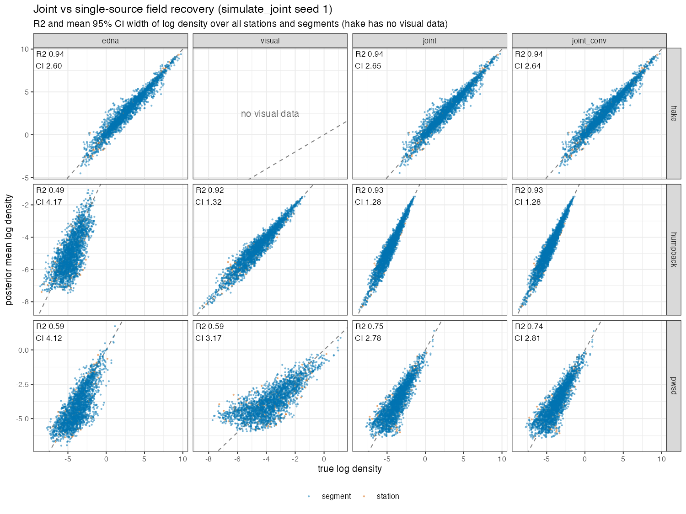

- **Hake is unchanged** by the joint fit, as it should be: it has no visual data.
- **Humpback** is carried by its 1,690 sightings. The joint fit is slightly
  better than visual-only, in R² and interval width, and much better than
  eDNA-only.
- **PWSD gains most.** With 153 sightings and detections in a minority of
  bottles, each source alone gives R² 0.59; together they give 0.75, with
  narrower intervals than either.
- **Conversion factors are identified.** eDNA alone cannot identify them (only
  density times conversion enters its likelihood). With the visual data, and a
  deliberately off-centre prior (normal(log 100, 2)), the joint model recovers
  them on the log scale: humpback 5.30 [5.05, 5.53] (truth 5.30) and PWSD 4.77
  [4.45, 5.08] (truth 4.70).
- **Coverage** of the true field is 92–96% in every cell.
- **Convergence.** No divergences in any fit. Max Rhat is 1.007 (visual-only),
  1.019 (joint) and 1.06 (conversion factors free); the eDNA-only fit's is 1.11,
  on $\theta_\text{bottle}$, the slowly mixing noise term (its field has
  converged).
- **Hyperparameters** are mostly covered. The misses: humpback's north–south
  length-scale reads 185–187 km [156, 219] against a truth of 150 in the visual
  and joint fits, and hake's and humpback's GP SDs sit slightly high.
- **Starting values matter.** From a flat starting field, the eDNA side of this
  dataset got stuck at its extreme hake hot spots (log density up to 9.5):
  every chain settled on near-zero copies with inflated noise (hake R² 0.19,
  $\theta_\text{bottle}$ 1.6 against 10), a state about 2000 log-density units
  worse than the truth's. `fit_joint()` now starts the field from the data (Ct
  through the standard curve, reads relative to junk, smoothed onto the HSGP
  basis), which recovers the true region from the first iteration.
- **Cost** on a laptop, 4 chains: eDNA-only, joint and joint with conversion
  factors free about 2 hours each; visual-only about 45 minutes.
- **Replicates.** This calm-sea comparison is one dataset. The replicates are
  being run with sea state instead (next subsection).

### With sea state (Beaufort)

The joint model's visual side can include the Beaufort sea-state covariate on
detection, as the visual model does (log σ shifts by β_bft per Beaufort unit
around Beaufort 3). Here the simulations draw a Beaufort value for every
segment (rougher to the north and offshore), and detection falls with it
(truth β_bft −0.08 for humpback, −0.15 for PWSD). For the same seed the field
and the eDNA data are identical to the calm-sea simulation; only the sightings
change. Every fit includes the covariate for both cetaceans. Seeds 1 and 2 are
done. Seeds 3–5 will be run after the next model change, negative-binomial
segment counts on the visual side (ROADMAP_2026-10-21, section 3), so that the replicate
table comes from the model that will go forward.

Field R² (mean 95% interval width):

| Species | Seed | eDNA only | Visual only | Joint | Joint, conversion factor free |
|---|---|---|---|---|---|
| Hake | 1 | 0.939 (2.60) | not surveyed | 0.938 (2.63) | 0.939 (2.64) |
| Hake | 2 | 0.900 (2.36) | not surveyed | 0.900 (2.38) | 0.900 (2.38) |
| Humpback | 1 | 0.494 (4.17) | 0.888 (1.32) | **0.890 (1.30)** | 0.890 (1.30) |
| Humpback | 2 | 0.585 (3.35) | 0.899 (1.17) | **0.906 (1.15)** | 0.906 (1.15) |
| PWSD | 1 | 0.589 (4.12) | 0.616 (2.86) | **0.741 (2.62)** | 0.742 (2.68) |
| PWSD | 2 | 0.493 (4.30) | 0.593 (4.33) | **0.698 (3.43)** | 0.697 (3.47) |

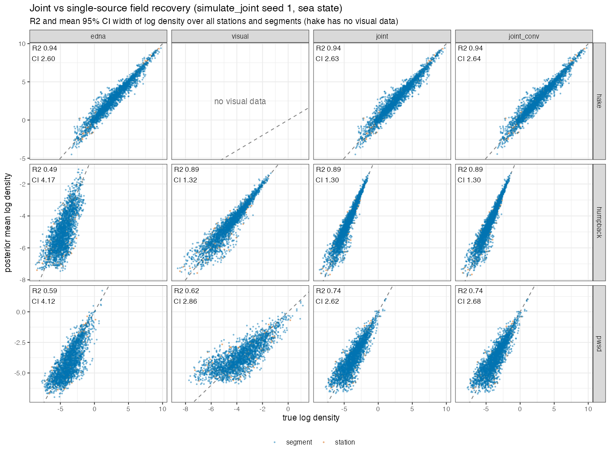

- **The pattern holds.** Hake is unchanged by the joint fit; humpback's joint
  fit edges out visual-only; PWSD gains most, from R² 0.59–0.62 for the better
  single source to 0.70–0.74 jointly, with narrower intervals.
- **Beaufort slopes:**

  | | Truth | Seed | Visual only | Joint |
  |---|---|---|---|---|
  | Humpback | −0.08 | 1 | −0.079 [−0.133, −0.025] | −0.078 [−0.132, −0.025] |
  | Humpback | −0.08 | 2 | −0.073 [−0.121, −0.027] | −0.068 [−0.118, −0.021] |
  | PWSD | −0.15 | 1 | −0.119 [−0.253, 0.008] | −0.089 [−0.209, 0.028] |
  | PWSD | −0.15 | 2 | −0.204 [−0.354, −0.062] | −0.227 [−0.379, −0.079] |

  Humpback's slope is recovered closely; PWSD's (about 150 detections) is
  covered in every fit but noisy, pulled toward zero in seed 1 and past the
  truth in seed 2.
- **Conversion factors** (log scale, conversion factors free): humpback 5.23
  [4.98, 5.46] and 5.28 [5.06, 5.50] (truth 5.30); PWSD 4.75 [4.44, 5.09] and
  4.60 [4.22, 4.97] (truth 4.70).
- **Convergence.** No divergences in any fit; max Rhat at most 1.06 (seed 1's
  eDNA-only fit, reused from the calm-sea run, 1.11 on
  $\theta_\text{bottle}$). Coverage of the true field is 89–98%.
- **Against calm sea (seed 1).** Humpback's R² drops by about 0.04 in the
  visual and joint fits: rough-sea segments carry less detection information,
  even with the covariate. PWSD's joint gain is unchanged (0.745 calm, 0.741
  with sea state).
- **Cost.** With the covariate, joint fits take about 3.5 hours on a laptop
  with two seeds running at once (the size-averaged ESW is computed per
  Beaufort level, which is expensive for PWSD's wide group sizes).

The earlier comparison on the old 500 × 1270 km box (seeds 1 and 2, 3 chains)
showed the same pattern: joint best for both cetaceans, hake unchanged, and
conversion factors recovered. One of its runs did not converge (one chain in a
mode with very large junk noise), which is why joint fits now run 4 chains.

### Seed 1 on the current set-up (2026-10-24; preliminary)

The same seed with sea state, on HSGP4eDNA v1.12 (junk redrawn per
replicate, no Ct floor in the simulator, the wider GP SD prior), with
negative-binomial segment counts for both cetaceans, non-centred junk noise
and `adapt_delta` 0.9 (4 chains of 800 + 800). **Preliminary:** the joint and
free-conversion fits were made before the bound on the NB size (Section 4.2)
and are being re-run with it on stats3; the eDNA-only and visual-only fits are
final. Seeds 2–5 follow.

| Species | eDNA only | Visual only | Joint | Joint, conversion factor free | Earlier joint (v1.5, Poisson) |
|---|---|---|---|---|---|
| Hake | 0.942 (2.65) | not surveyed | 0.942 (2.65) | 0.941 (2.64) | 0.938 |
| Humpback | 0.491 (4.34) | 0.907 (1.28) | **0.917 (1.26)** | 0.916 (1.26) | 0.890 |
| PWSD | 0.583 (4.15) | 0.595 (3.51) | **0.743 (2.91)** | 0.743 (2.94) | 0.741 |

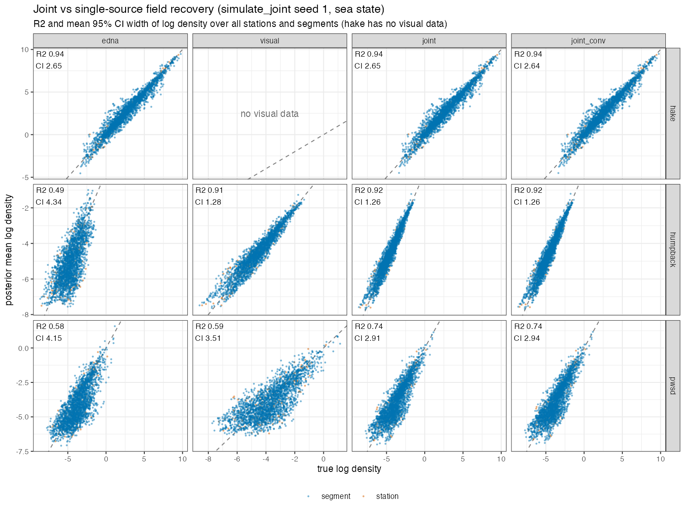

- **The pattern holds:** hake unchanged, humpback slightly better jointly
  than from the visual data alone, and PWSD gains most (R² 0.74 jointly
  against 0.58–0.60 from either source).
- **Conversion factors** (log scale, free): humpback 5.19 [4.95, 5.41]
  (truth 5.30), PWSD 4.62 [4.31, 4.94] (truth 4.70).
- **Beaufort slopes:** humpback −0.048 [−0.104, 0.002], PWSD −0.094 [−0.227,
  0.035] (truth −0.08, −0.15); covered, pulled towards 0 a little more than
  with Poisson counts.
- **NB sizes:** humpback $\phi$ about 360 (the simulated sightings are
  Poisson, so a large $\phi$ is right); PWSD about 6 with a long upper tail
  (about 100 detections cannot tell).
- **Coverage** of the true field 92–97%; no divergences; max R-hat 1.07.
- **Cost:** each eDNA, joint and free-conversion fit took about 8 hours on a
  laptop, about twice the earlier runs (the non-centred junk noise, the
  smaller step size and the new simulator); the visual-only fit 73 minutes.

> **[REVIEW] What is not yet shown here.**
> (1) Prior and posterior predictive checks for the joint model, in the style of
> Sections 3 and 4: not produced. (2) The real eDNA and joint fits are running
> (eDNA-only, and joint with the cetaceans' conversion factors free; the
> visual-only fit is in Section 4.5.2); they are the first fits with the real
> Ct values, estimated standard curves, dilutions and depth smooth together.

## What the real-data objects provide

`R/01_load_muri.r` writes an eDNA object and a visual object with the same
structure as the simulators' output, on a common domain and UTM origin, so the
same formatters apply to the joint model. Since 2026-10-21 the eDNA object
carries hake Ct per well with per-plate standard curves, filtered volume per
bottle, dates, target depths, dilutions and the hake standards (Section 3.3;
ROADMAP_2026-10-21, section 5), and the joint model uses them (Section 3.1).
`real_joint_object()` puts the two objects together in the simulator's shape,
with one bottom-depth spline for bottles and segments, and
`R/fit_joint_real.r` fits it eDNA-only, visual-only and jointly with the
cetaceans' conversion factors free. The template volume is confirmed (2 µL);
the elution volume is still assumed, so the absolute conversion factor is not
yet meaningful in physical units. The visual object carries the Beaufort ≤ 5 effort, segment
visibility and the per-species detection and count settings. The visual
data supply the absolute density.

# For discussion

The questions below are where input would help most. More detail is in
ROADMAP_2026-10-21 (sections 5b and 6).

## For Len (distance sampling and the statistical model)

1. **Hazard-rate shape below 1.** The real humpback fit has $b$ = 0.98 [0.78,
   1.23]. The plan is to bound $b \ge 1$ in both models and refit; is that the
   right constraint, or should the prior do it?
2. **A flexible detection function.** The plan is a mixture of two
   half-normals (monotone non-increasing by construction) rather than cosine
   adjustments with constrained optimisation. Does that cover the shapes you
   would want to allow?
3. **Model selection inside the Stan model.** Currently the detection
   covariates are chosen beforehand by AIC (Distance). Options: PSIS-LOO on the
   detection and segment log-likelihoods, or shrinkage priors on the covariate
   effects. Which would you prefer?
4. **Group-size checks.** Planned: posterior predictive checks of the detected
   (size-biased) group sizes against the observed, per species.
5. **The length-scale floor.** The real visual fits sit at the shortest
   length-scale the basis represents (about 40 × 65 km) at both budgets
   tried, and the cause is not clustered sightings (Section 4.4.2). We treat
   it as a resolution limit; density does not change with the budget.
6. **Simulation design.** Should a scenario with more PWSD detections (for
   example 3× the density) be added, to see whether PWSD's weaker recovery is
   only sample size?

## For Ole (the eDNA data)

1. **Hake in the field negatives.** If the hake in the negatives is in the
   extract (from filtering or handling), it raises the qPCR copies and the
   hake reads together, and the cetacean estimates, which use hake as the
   quantitative anchor, are unaffected. If it enters only the qPCR (for
   example from the synthetic standards on the same plates), it inflates hake
   copies without reads, which biases the cetacean copies upward in low-hake
   bottles. Which is more likely?
2. **30EtOH samples** (56 of 569 metabarcoded bottles): dropped for now.
   Could the 20–30% DNA loss be treated as known instead?
3. **Read depth.** MarVer1 replicates with fewer than 1,000 reads are dropped
   (per replicate, stricter than the lab's per-sample rule): 136 of 1,438.
4. **The 1,258 hake qPCR samples without metabarcoding** (second bottles,
   other depths, including 100 m, and 19 more stations): planned as a second
   step, mainly to estimate the bottle-to-bottle noise.
5. **Conversion factors.** The simulator's values (copies per animal per
   litre per km², hake 10, humpback 200, PWSD 110) are placeholders. Do they
   give realistic copies and detection rates? The real joint fit will
   estimate the cetaceans' values.

## What is running

On the stats3 server since 2026-10-26: the real eDNA-only fit and the real
joint fit with free conversion factors (both 4 chains of 1000 + 1000; about
two more days at the server's current load), and seed 1's joint and
free-conversion fits with the NB bound. Seeds 2–5 of the simulation follow
later in the week.

# To do

Drawn from ROADMAP_2026-10-21 (item numbers in brackets), roughly in order.

**Now**

1. Finish the stats3 runs and write them up: the real eDNA-only and joint
   fits (§5.7) and seed 1's joint fits with the NB bound (§3.2).
2. Simulation replicates, seeds 2–5 with sea state, plus the
   without-Beaufort contrast for seeds 1–2; a summary table across seeds
   (§3.2).

**Next**

3. Bound the hazard-rate shape at $b \ge 1$ and refit humpback (§5b.3).
4. Predictive checks: group sizes (§5b.6), and prior and posterior checks
   for the joint model (§3.5).
5. Prediction on a grid in the joint model, for maps and for the realistic
   simulation (§4).
6. The realistic simulation (tier 2): earlier density surfaces sampled at the
   real transects and stations (§4); needs the choice of surfaces.
7. Add the hake qPCR-only samples, mainly to estimate the bottle-to-bottle
   noise (§5.8).
8. Bring Sections 2–4 of this document to the 35°N set-up (§3.6).

**Later**

9. A flexible detection function: a mixture of two half-normals (§5b.4).
10. Model selection inside the Stan model (§5b.5).
11. A spatial term in the junk (§5b.7).
12. Check that the conversion factors are realistic (§5b.8); a simulation
    scenario with more PWSD detections (§5b.9).
13. Test whether eDNA amount is proportional to density, with an elasticity
    (§5.5).
14. HSGP4eDNA's own validation on the 35°N domain, and a release (§3.4).

# Limitations and open issues

## Data

- **qPCR Ct and standard curves.** Ct per well and the hake standards are in
  the eDNA object, and the joint model estimates the per-plate curves from
  the standards (Section 3.1); the real fits with them are running. The template volume
  is 2 µL for both assays (confirmed); the elution volume (assumed 100 µL) is a
  placeholder.
- **Hake in field negatives.** 73 of 114 evaporated-DI and 25 of 72 lab-DI
  field-negative wells detect hake (about 1–2 copies/µL on average, up to 12;
  a third of the field bottles hold less). The lab advises ignoring it. For the
  cetaceans, which use hake only as a quantitative anchor, this is harmless if
  the hake DNA is in the extract (qPCR copies and hake reads rise together and
  cancel), but biases cetacean copies upward in low-hake bottles if it enters
  only the qPCR (e.g. from the synthetic standards), and it adds hake
  variability to the shared bottle-noise term. A sensitivity fit without the
  lowest-hake bottles is planned (ROADMAP_2026-10-21, section 6).
- **Read depth.** MarVer1 replicates with fewer than 1,000 reads are dropped as
  failed PCRs (136 of 1,438); low read depth is unrelated to the bottles' hake
  DNA, so the cut does not remove the low end selectively.
- **Survey timing.** The eDNA dates are in the qPCR lab's file (from
  2 July 2019); the visual survey is from 2018. Both are treated as one
  snapshot of the same field.
- **Dilutions.** In the loaded data 393 hake qPCR wells are at 1:5 and
  metabarcoding replicates are at 1 to 100-fold. Both are in the object as log
  offsets on the aliquot copies, for the model to use once HSGP4eDNA takes
  them.
- **Contamination.** *Gallus* reads are dropped from the junk and the
  replicate totals; the new MarVer1 table has no human or cattle reads.
- **30EtOH samples.** 56 of 569 metabarcoded bottles lost about 20 to 30% of
  their DNA in a lab mix-up; they are dropped for now.
- **Perpendicular distance missing** for 73 on-effort sightings, which are excluded.
- **Sea state.** Visual effort is restricted to Beaufort ≤ 5 (1.6% of the
  effort removed).

## Models

- **g(0) = 1** in the visual model; there is no availability or perception bias
  correction.
- **Beaufort and visibility are segment means**, not the values at each
  sighting, rounded to 0.5 for the detection-condition cells. Visibility is
  treated as a continuous scale on $\sigma$; where it is shorter than the
  truncation distance (660 km of humpback effort, 59 km for PWSD) it could cut
  detection off rather than only narrow it.
- **The length-scale floor.** The real visual fits put the length-scales at the
  shortest scale the basis represents (Section 4.5.2); maps are resolved to
  about 40 × 65 km, and the length-scale and marginal-SD estimates describe the
  basis limit.
- **Unidentified animals** (baleen whales, unidentified dolphins) are not
  apportioned to species.
- **Water-column depth** is a known fixed offset in the simulations; on the
  real data it is replaced by a per-species smooth over the target depths
  (3 df, anchored at the surface), estimated in the model.
- **Hazard-rate shape** $b$ is not bounded below at 1 (Section 6).
- **Run time.** On the current set-up a joint fit to a simulated survey takes
  about 8 hours on a laptop, and the real fits longer.
- **Equal amplification efficiency.** The metabarcoding model makes expected read
  shares follow aliquot copies relative to junk, so it assumes MarVer1 amplifies
  every species and the junk background equally. With a fixed cycle number a
  species' efficiency difference is a constant multiplier: it shifts that
  species' surface but not its shape. For hake, qPCR fixes the absolute level;
  for the cetaceans it biases eDNA-only absolute density, and in the joint model
  it is absorbed into the conversion factor, which then means copies per animal
  times the species' relative amplification bias. If cycles or dilutions vary
  between samples, the bias also enters the spatial pattern. *(Update,
  2026-10-21: MarVer1's amplification efficiency is the same for hake,
  humpback and PWSD, so for these three species the assumption holds; the
  planned amplification term in HSGP4eDNA v1.7 will be switched off here.
  ROADMAP_2026-10-21, section 5.)*
- **Projection.** Effort to about -114.5 degrees longitude is far from UTM zone 10's
  central meridian, so distances there are distorted by a few percent.
- **Sampling cost.** The reference eDNA fit takes about 15 hours; real-data fits of
  both models are long, and the fits shown here use fewer chains and iterations
  than the validation runs.

# Reproducing this document

Run from the repository root (a CmdStan installation and the submodule are needed):

```bash
Rscript docs/explainer/05_fig_simulation.R     # simulation figures (needs the eDNA sim object)
Rscript docs/explainer/01_fit_edna_sim.R       # eDNA fit on simulated data
Rscript docs/explainer/06_fig_edna_sim.R       # eDNA figures
Rscript docs/explainer/02_fit_visual_sim.R     # visual fit on simulated data
SP=humpback Rscript docs/explainer/03_fit_visual_real.R   # real visual fit (also SP=pwsd)
SP=humpback M_MAX=800 TAG=real800 Rscript docs/explainer/03_fit_visual_real.R   # refit at twice the basis budget
Rscript docs/explainer/08_fig_key_choice.R     # detection-key comparison on the real distances
Rscript docs/explainer/04_fit_edna_real.R      # real eDNA fit (metabarcoding only)
Rscript R/check_count_dispersion.r            # clustered-sightings check (Section 4.4.2; also USE_NB=1, NB_SIZES=0.3)
SPECIES=pwsd Rscript R/fit_visual_real.r       # 35°N real visual fits (Section 4.5.2; M_MAX=1600, USE_VIS=0 for the comparisons)
Rscript docs/explainer/07_fig_visual.R         # visual figures
SEED=1 Rscript R/compare_joint.r               # joint vs single-source fits (Section 5; ~7 h on a laptop)
SEA_STATE=1 SEED=1 Rscript R/compare_joint.r   # with sea state, current set-up (Section 5.2.2; ~8 h per fit)
Rscript R/fit_qpcr_standards.r                 # hake standard curves (Section 3.3)
MODES=edna Rscript R/fit_joint_real.r          # real-data fits (also visual, joint_conv)
cp outputs/joint/compare_s1/compare_joint.png docs/figures/joint_compare_s1.png
quarto render docs/explainer.md --to html --embed-resources
```

Fits are saved under `outputs/explainer/` (git-ignored); the figures are in
`docs/figures/`.

From HSGP4eDNA v1.4 the default basis budget is 800, so the first real visual
fit already uses about 800 functions. The "twice the budget" refit would be
`M_MAX=1600 TAG=real1600`. The real eDNA fit (`04`) also uses the default
budget, and will take roughly twice as long.
